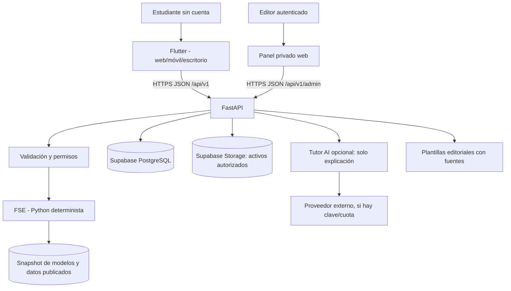
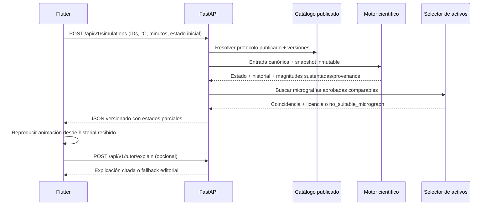

# 03 — Arquitectura de software FERROLAB

**Versión:** 2.0 · **Patrón:** monolito modular con motor científico puro y cliente Flutter.  
**Dependencias:** `02_PRD.md`, `04_Motor_Cientifico_FSE.md`, `05_Modelo_de_Datos.md`, `06_Backend_FastAPI.md`.

## 1. Visión ejecutable



**Lectura correcta:** FSE recibe un snapshot científico inmutable por versión; FastAPI consulta/actualiza el catálogo y presenta resultados. El tutor puede estar ausente y el producto continúa útil. El frontend **jamás** habla con `service_role` ni decide cuantías científicas.

## 2. Componentes y responsabilidades

| Módulo | Responsabilidad | Prohibido |
|---|---|---|
| `apps/flutter_client` | Presentación, formularios, animaciones, almacenamiento local, i18n. | Resolver transformaciones metalúrgicas reales. |
| `apps/admin_web` | CRUD editorial, revisión de imágenes/datasets, métricas mínimas. | Publicar sin revisión/permiso; incrustar credenciales privadas. |
| `services/api` | Validación, autenticación, orquestación, rate limits, serialización. | Calcular ciencia con prompts o aceptar perfiles físicos arbitrarios del cliente. |
| `packages/fse` | Algoritmos deterministas, dominio, unidades y provenance. | Consultar LLM/red durante el cálculo. |
| `packages/contracts` | OpenAPI/JSON Schema, IDs y enums compartidos. | Divergir en campos/estados entre frontend y backend. |
| `database` | Datos versionados, auditar publicaciones, RLS, migraciones. | Mezclar borradores con datasets publicados. |
| `services/tutor` | Explicar exclusivamente contexto permitido, sin cambiar resultados. | Generar dureza, porcentajes de fase o referencias ficticias. |

**Repositorio sugerido:**

```text
FERROLAB/
├── README.md
├── docs/01_...15_...
├── apps/flutter_client/
├── apps/admin_web/            # puede ser Flutter Web con rutas/admin autenticadas
├── services/api/app/{api,core,domain,services,repositories,auth}/
├── packages/fse/fse/{models,protocols,kinetics,evidence,validation}/
├── packages/contracts/{openapi,schemas}/
├── database/{migrations,seeds,policies}/
├── tests/{scientific,api,security,integration,e2e}/
├── scripts/
├── .github/workflows/
└── .env.example
```

Si para un solo desarrollador `admin_web` separado complica el MVP, puede implementarse en el mismo proyecto Flutter Web **con rutas protegidas y API admin separada**. Jamás basta con ocultar un botón para autorizar operaciones.

## 3. Ciclo de una simulación



**No hay streaming de física en tiempo real como requisito P0.** El backend retorna un historial térmico discretizado; Flutter lo reproduce aceleradamente sin modificar tiempo físico o resultados. Para cálculos largos futuros, se podría añadir un trabajo asíncrono, pero no implementarlo sin evidencia de necesidad.

## 4. Datos y revisión científica

Una ficha de material no es una sola fila con números sueltos: composición (rangos y origen), condición inicial, tratamiento/protocolo, modelos, evidencias y activos son entidades relacionadas. Todo paquete publicado recibe `dataset_version`, fechas y checksum. Nunca consultar borradores para simular en producción. Admin crea `draft`, revisor autorizado marca `reviewed`, editor publica snapshot; la publicación invalida caché y conserva versiones anteriores para reproducibilidad.

Un registro bibliográfico **no** equivale a una correlación validada: cada predicción debe apuntar a una observación, figura, ecuación, rango o tabla que sea legítimamente accesible. Si no existe, el campo es nulo.

## 5. Seguridad (límites de confianza)

**Público:** rutas de lectura y simulación por FastAPI con límites IP/cliente, validación estricta y protección frente a abuso. El estudiante no se autentica; nunca confundir anónimo con permiso de edición. No recolectar nombres ni edades. **Privado:** Supabase Auth/identidad verificada, autorización por rol en backend, registro de auditoría. Los secretos (`DATABASE_URL`, clave Supabase servidor, clave proveedor IA, signing secrets) se obtienen de variables de entorno del backend y se rotan.

- Habilitar **RLS** en tablas expuestas; privilegiar exposición mínima usando API como mediador.
- `service_role`/secret keys **nunca** en web, Flutter, Git o logs.
- La `anon`/publishable key por sí sola **no** concede permisos; las políticas y roles hacen el control.
- Rutas `/v1/admin/*` deniegan acceso sin autenticación y rol, incluso con URL descubierta.
- Aplicar CORS con orígenes permitidos explícitos, TLS, protección de cabeceras y validación de tamaño/forma de payloads.
- URLs de activos privados deben expirar; almacenamiento público solo de recursos revisados para publicación.
- Evitar guardar mensajes de estudiantes a IA por defecto; usar límites y no incluir datos privados en prompts.
- Registrar incidentes y permitir revocar credenciales sin recompilar la aplicación.

### Modelo de amenazas resumido

| Amenaza | Mitigación | Prueba |
|---|---|---|
| Cliente altera `cooling_profile_id` | API ignora/rechaza el campo, resuelve protocolo aprobado. | Petición manipulada ⇒ 422. |
| Se filtra `service_role` | Ninguna clave privada en assets/env del cliente. | Escaneo de bundles/CI. |
| Usuario público publica una curva | Escribir solo admin + flujo `reviewed`. | 401/403 + RLS. |
| Prompt injection en fuente/consulta | Contexto de IA limitado a registros confiables, salida validada. | Tests adversariales. |
| Ataques por costos en IA | Límite por IP/ventana y apagado por cuota. | Prueba de 429 y fallback. |
| Datos experimentales falsos | Auditoría, revisión, checksums, golden tests. | Verificación de provenance. |

## 6. Escalabilidad y presupuesto

**MVP:** un proceso FastAPI de tamaño pequeño, Postgres gestionado, Storage optimizado y Flutter Web estático. Evitar Kubernetes, Redis, colas y GPU hasta medir latencias y concurrencia reales. Para ~500 personas en total no conocemos la concurrencia máxima; medir antes de prometer capacidad. Una plataforma con plan gratuito puede cambiar cuotas o suspender proyectos inactivos; documentar límites vigentes al despliegue. Tutor externo opcional puede tener costo variable y requerir límites estrictos.

**Estrategias de bajo costo:** caché de catálogos públicos con ETag y versión, compresión de imágenes, miniaturas, CDN si está incluida, precálculo **solo** de casos científicamente válidos, llamadas IA manuales/coste acotado, registro de eventos agregados. No persistir por defecto una simulación anónima en PostgreSQL si no es necesaria; usar `simulation_id` efímero y almacenamiento local.

## 7. Rendimiento, consistencia y resiliencia

- Formularios y animación no dependen de llamadas continuas al servidor; interfaz responde de inmediato.
- API con timeouts razonables, límites de payload y `request_id` para diagnóstico; mensajes legibles por estado.
- `dataset_version` fija el conjunto de evidencias durante una simulación; despliegues no pueden mezclar versiones en un mismo resultado.
- Si red cae antes del cálculo: reintentar; si cae después: conservar resultado ya recibido en memoria/local si se habilitó P1.
- Si IA falla: respuesta editorial revisada, no error global.
- Si la BD está indisponible: no simular usando datasets obsoletos silenciosamente; un snapshot publicado y versionado puede servir como modo degradado si esa política se implementa y comunica.
- Monitorizar ratio de errores, tiempos p95, consumo de almacenamiento/API y eventos de publicación de admin; no grabar datos personales innecesarios.

## 8. Decisiones de arquitectura pendientes y gates

| Decisión | Opción inicial propuesta | Verificación antes de uso |
|---|---|---|
| Hosting FastAPI | proveedor con plan apropiado o ejecución local para demo | Disponibilidad, tarifas, persistencia, suspensión, TLS. |
| UI admin | Flutter Web reutilizando Design System | Roles backend y pruebas de autorización. |
| Estado Flutter | Riverpod u opción equivalente **una sola** | Bloqueo de versión compatible y test. |
| DB acceso | SQLAlchemy 2 + Alembic para server; Supabase para Auth/Storage | Conexión, RLS, compatibilidad de migraciones. |
| IA | deshabilitada hasta confirmar cuota/proveedor | Privacidad, tarifa, caché y apagado seguro. |
| Diagrama científico | renderer vectorial Flutter | Datos verificables y precisión de ejes. |

## 9. Definición de implementado

Los módulos se pueden ejecutar localmente; tests científicos/API/seguridad/UX básicos pasan; Swagger/OpenAPI coincide con contratos; no hay secretos en cliente; se puede publicar y revertir una versión de dataset; el usuario puede simular un caso permitido o recibir un estado de insuficiencia claro; la app web puede desplegarse sin IA.
