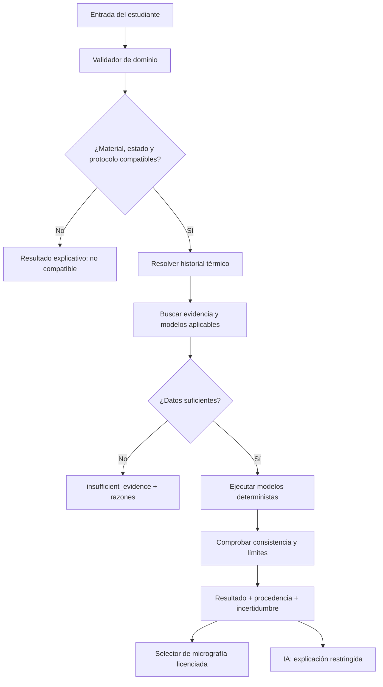

# FERROLAB — 04. Motor Científico (FSE)

**Versión de especificación:** 2.0 · **Estado:** diseño para implementación · **Idioma fuente:** español  
**Documento precedente:** `03_Arquitectura_Software.md` · **Documento siguiente:** `05_Modelo_de_Datos.md`

> **Mandato para Claude Code:** implementar un motor determinista y verificable. Ninguna cifra científica de ejemplo de este documento constituye un dato validado para producción. Si faltan datos, devolver `insufficient_evidence` y explicar por qué; jamás fabricar resultados.

## 1. Propósito y límites

El **Ferrolab Scientific Engine (FSE)** transforma un historial térmico, un material y su estado inicial en **predicciones educativas condicionadas por supuestos**, con fuentes, límites de aplicación y nivel de evidencia. No sustituye Thermo-Calc, ensayos de laboratorio, diagramas experimentales específicos ni diseño de tratamientos industriales. Los modelos se ejecutan en Python, aislados de Flutter y de la IA generativa.

### Objetivos verificables

1. Misma entrada + misma versión de datos/modelos = misma salida.
2. Cada número informa unidad, método, fuente, supuestos, rango de validez e incertidumbre cuando esté disponible.
3. No estimar fracciones de fase, dureza, tamaño de grano o curvas sin datos/modelos adecuados para el material y la trayectoria térmica.
4. Distinguir **fases cristalográficas** (ferrita, austenita, cementita, etc.) de **microconstituyentes** (perlita, bainita, martensita, grafito en fundición). No sumar categorías solapadas como si fueran fracciones independientes.
5. Permitir explicar por qué un caso está fuera de rango sin bloquear el aprendizaje.
6. No presentar bibliografía listada como evidencia de una cifra sin una referencia concreta, verificable y pertinente.

## 2. Alcance v1

| Material | Identificador | Consideraciones científicas |
|---|---|---|
| Acero AISI 1045 | `aisi_1045` | Acero al carbono medio; composición y estado inicial por lote/rango, no una composición única universal |
| Acero AISI 8620 | `aisi_8620` | Acero aleado de bajo carbono, usado habitualmente en cementación; sin cementación previa no atribuir propiedades de una capa cementada |
| Fundición gris ASTM A48 Clase 30 | `astm_a48_class_30` | ASTM A48 especifica una clase de resistencia de fundición gris, **no** una composición ni una microestructura única; grafito laminar y matriz dependen del proceso y pieza |

**Tratamientos solicitados:** temple, revenido, recocido, normalizado, austempering y martempering. **No asumir que los 18 pares material–tratamiento son válidos o equivalentes.** Cada combinación tendrá estado `supported`, `conditional`, `educational_only` o `unsupported`, con motivo documentado. Para fundición gris y tratamientos especiales, exigir bibliografía específica y evitar extrapolar modelos de acero.

### Parámetros de usuario

- `material_id`: una de las tres opciones.
- `treatment_id`: uno de los seis tratamientos.
- `target_temperature_c`: selector entre ambiente y 1600 °C como **rango de interfaz**, no como rango científicamente permitido.
- `hold_time_min`: duración no negativa, con límites configurables por tratamiento.
- `initial_condition_id`: estado inicial definido por ficha de material; mostrarlo y permitir selección solo si existen estados verificados.

### Parámetros automáticos, pero visibles

- Medio de enfriamiento **bloqueado para el usuario** y determinado por un **protocolo validado de material + tratamiento**, nunca solo por material. No existe un único medio óptimo universal: geometría, severidad, tensiones y objetivo influyen.
- Perfil de calentamiento y enfriamiento, temperatura de inicio, duración de transferencia y temperatura final: usar perfiles educativos explícitos, con fuente y supuestos.
- Para **austempering** y **martempering**, el protocolo debe representar etapas y baños/mesetas correspondientes; no reducirlos a un enfriamiento simple.
- Para **revenido**, se requiere un estado inicial previamente endurecido o una condición inicial documentada; no inferir martensita previa automáticamente.

**Regla:** si se elige una temperatura extrema (p. ej., 1600 °C) no se debe simular como tratamiento sólido válido cuando corresponda fusión, degradación o un régimen fuera de los datos. Mostrar advertencia o impedir el cálculo; no extrapolar.

## 3. Modelo conceptual



## 4. Contratos de datos

### Solicitud de simulación

```json
{
  "material_id": "aisi_1045",
  "treatment_id": "quench",
  "initial_condition_id": "example-condition-id",
  "target_temperature_c": 850,
  "hold_time_min": 30,
  "locale": "es"
}
```

**850 °C y 30 min son parámetros ilustrativos, no una receta validada ni garantía de microestructura o dureza.**

### Respuesta de resultado (ejemplo de estructura, sin resultados inventados)

```json
{
  "request_id": "example-generated-id",
  "simulation_status": "insufficient_evidence",
  "dataset_version": "not-published-example",
  "protocol_version": null,
  "engine_version": "2.0.0",
  "model_version": null,
  "input": {
    "material_id": "aisi_1045",
    "treatment_id": "quench",
    "initial_condition_id": "example-condition-id",
    "target_temperature_c": 850,
    "hold_time_min": 30
  },
  "compatibility_status": "conditional",
  "protocol": null,
  "thermal_history": [],
  "results": {
    "phase_fractions": null,
    "microconstituent_fractions": null,
    "hardness": null,
    "grain_size": null,
    "mechanical_properties": null
  },
  "micrograph": null,
  "diagrams": [],
  "warnings": [
    {
      "code": "MISSING_VALIDATED_PROTOCOL",
      "message_key": "scientific.missing_protocol"
    }
  ],
  "evidence": [],
  "assumptions": [
    "Geometry omitted: educational simplification"
  ]
}
```

Los campos ausentes se representan como `null`, **nunca cero**. La API debe soportar resultados parciales, por ejemplo `partial_result` con una predicción respaldada y otras magnitudes no disponibles. Los identificadores y números del ejemplo son **sintéticos, no aprobaciones del tratamiento**.

## 5. Motor por módulos

### 5.1 Catálogo de materiales

Guardar: designación y norma, composición por rangos y su procedencia, condición inicial, microconstituyentes observados, tratamientos admitidos, propiedades iniciales (si verificadas), fuentes y versión. Para ASTM A48 Clase 30, registrar explícitamente variabilidad de matriz y grafito y no asignar una composición estándar inventada.

### 5.2 Catálogo de tratamientos

Cada tratamiento define: finalidad, condiciones previas, etapas, variables controladas, perfiles térmicos compatibles, restricciones, medio automático, transformaciones esperables **condicionales**, riesgos, referencias y advertencias educativas.

- **Temple:** austenitización apropiada (si procede), mantenimiento y enfriamiento; la martensita depende de composición, austenita previa y trayectoria.
- **Revenido:** necesita estado templado o condición endurecida documentada; registrar el efecto de tiempo y temperatura con correlaciones validadas.
- **Recocido:** especificar variante (completo, subcrítico, etc.) antes de modelar.
- **Normalizado:** austenitización y enfriamiento al aire bajo supuestos documentados.
- **Austempering:** austenitización, enfriamiento a baño isotérmico y mantenimiento en región bainítica cuando aplique.
- **Martempering:** austenitización, enfriamiento a baño próximo a Ms y etapa de igualación antes del enfriamiento final; no confundir con austempering.

### 5.3 Historial térmico

El cálculo recibe una secuencia ordenada de etapas: `heat`, `hold`, `transfer`, `cool`, `isothermal_hold`, con `t_s` y `temperature_c`. La animación acelerada de 12 s, por ejemplo, **solo reproduce** este historial; no altera los tiempos físicos del modelo. No asumir que un único par temperatura–tiempo describe todo el ciclo: el protocolo aporta las demás etapas.

### 5.4 Transformaciones y fases

Priorizar **tablas/curvas experimentales específicas** con interpolación **solo dentro de rangos documentados**. Las curvas TTT describen transformación isotérmica y las CCT transformación durante enfriamiento continuo: **no intercambiarlas**. Para trayectorias mixtas, usar un modelo compatible y validado o declarar insuficiencia.

- **Andrews (1965):** estimación de `Ms` únicamente cuando composición, unidades y rango de validez correspondan a la formulación seleccionada. Registrar coeficientes desde fuente verificable, no de memoria.
- **Koistinen–Marburger (1959):** una relación empírica para fracción de martensita bajo supuestos específicos. No usarla como predictor universal de todas las fases, ni en fundición gris sin validación.
- **Cinética difusional:** usar parámetros de Avrami/JMAK u otros únicamente con ajustes experimentales para el sistema concreto; no crear coeficientes arbitrarios.
- **Fracciones:** validar rango [0,1], normalización por categoría y balance físico; reportar si el balance es aproximado.

### 5.5 Dureza y propiedades

La dureza no se deduce de una fase con una constante universal. Necesita datos de composición, tratamiento, estado inicial, trayectoria y correlación validada. Distinguir HV, HBW y HRC; ASTM E140 se utiliza para **conversiones aproximadas dentro de su alcance**, no para generar dureza desde cero. Si la conversión cae fuera del rango aplicable, rechazarla.

No inferir automáticamente límite elástico, resistencia última, ductilidad, tenacidad o aplicaciones exactas a partir de una dureza aislada. Mostrar solo propiedades respaldadas o descripciones cualitativas etiquetadas.

### 5.6 Tamaño de grano

ASTM E112 define métodos de **medición** del tamaño de grano a partir de una imagen/medición adecuada, no una ecuación general para predecirlo a partir de temperatura y tiempo. No reportar número ASTM si no hay imagen calibrada o modelo de crecimiento validado. ASTM E562 permite estimación por conteo de puntos sobre imágenes representativas; no confundir una fracción predicha con una fracción medida.

### 5.7 Selección de micrografías

El FSE emite etiquetas científicas y condiciones estimadas. Un servicio independiente busca micrografías con metadatos: material/composición, tratamiento, estado inicial, método de preparación, técnica (óptica/SEM), aumento, barra de escala, constituyentes, licencia, autor y enlace de fuente.

**Orden de preferencia:** coincidencia experimental exacta → referencia comparable con advertencia → ilustración didáctica claramente rotulada → no disponible. No generar una imagen fotorrealista y presentarla como observación experimental. La IA puede mejorar contraste/rotulación en una copia **si la licencia lo permite**, sin alterar rasgos metalúrgicos ni falsear evidencia. Zoom digital no crea detalle; cambios de 100× a 1000× requieren micrografías reales de aumentos diferentes o una advertencia de interpolación visual. Las etiquetas de fase solo se dibujan sobre anotaciones validadas.

## 6. Evidencia y fuentes

Bibliografía objetivo (ver `12_Bibliografia_y_Fuentes.md`): ASM Handbook 4A/4D/9/1, atlas TTT/CCT de Vander Voort, Krauss, Bhadeshia–Honeycombe, Totten, Callister, Askeland, Avner y Angus; normas ASTM A48, A255, E112, E562 y E140; trabajos originales de Andrews y Koistinen–Marburger.

**No existe lectura automática garantizada de libros protegidos.** Claude Code no debe afirmar que extrajo tablas, curvas o valores de libros a los que no tiene acceso legal. Para poblar el motor, usar datos públicos verificables, documentos con acceso autorizado y registros curados. Registrar página/figura/tabla, edición, licencia, transcripción, revisión y fecha. La bibliografía por sí sola no constituye validación de un cálculo.

### Datasets de imágenes: política de uso

| Repositorio | Tratamiento inicial |
|---|---|
| UHCSDB | Verificar licencia por archivo y pertinencia metalúrgica; alto carbono no equivale a 1045/8620/A48 |
| RODARE carburos | Candidato; confirmar registro concreto y CC BY 4.0 antes de incorporar |
| NIST UHCS Microconstituent Annotations | Revisar CC BY-SA 3.0, atribución y obligaciones sobre derivados |
| Aachen–Heerlen | Bloquear uso en producto hasta confirmar licencia |
| MetalDAM | Bloquear uso hasta resolver contradicción MIT vs CC BY-NC-ND y permisos del conjunto |

Una imagen de carburos, acero de manufactura aditiva o acero ultralto carbono **no** es evidencia directa de una microestructura de AISI 1045, AISI 8620 o ASTM A48 Clase 30. El algoritmo debe poder devolver `no_suitable_micrograph`.

## 7. Confianza y advertencias

No mostrar insignias verdes por defecto. Niveles propuestos:

- `validated`: contrastado con referencias experimentales del dominio especificado.
- `bounded_estimate`: estimación dentro de un modelo validado, con incertidumbre conocida o declarada.
- `qualitative`: tendencia educativa sin cifra cuantitativa respaldada.
- `insufficient_evidence`: no se puede concluir.
- `unsupported`: combinación físicamente o metodológicamente no cubierta.

La confianza se asigna **por resultado**, no a toda la simulación de manera indiscriminada. No presentar una cifra de precisión espuria.

## 8. API interna del FSE

Interfaces Python sugeridas:

```python
class ScientificEngine:
    def validate(self, request: SimulationRequest) -> ValidationReport: ...
    def build_thermal_history(self, request: SimulationRequest) -> ThermalHistory: ...
    def simulate(self, request: SimulationRequest) -> SimulationResult: ...
    def explain_provenance(self, result_id: str) -> ProvenanceReport: ...
```

El código científico no realiza peticiones a modelos de IA. Los modelos y datos se inyectan mediante repositorios versionados. Recomendación: Pydantic para esquemas, `pytest` para pruebas, unidades explícitas y tipado estricto. No hacer consultas de red en el núcleo de cálculo: usar un snapshot científico versionado para reproducibilidad.

## 9. Pruebas obligatorias

1. **Determinismo:** entradas y versiones idénticas generan resultados idénticos.
2. **Balance:** fracciones dentro de [0,1] y suma coherente según la taxonomía usada.
3. **Dominio:** bloquear interpolaciones fuera de datos y temperaturas incompatibles.
4. **Revenido:** exigir condición inicial válida.
5. **8620:** no suponer cementación ni dureza superficial de capa inexistente.
6. **A48:** no asignar composición única o diagrama CCT de acero por defecto.
7. **TTT/CCT:** verificar tipo de trayectoria y origen del diagrama.
8. **E140/E112/E562:** no usar normas de medición/conversión como predictores universales.
9. **Trazabilidad:** toda salida numérica debe tener `source_id` y `model_version`.
10. **Sin evidencia:** respuesta explícita sin números ficticios.
11. **Imágenes:** bloquear activos sin licencia confirmada o sin coincidencia adecuada.
12. **Regresión:** comparar contra casos de referencia revisados por un especialista y registrar tolerancias justificadas.

**No escribir pruebas con valores esperados inventados** (por ejemplo, «1045 a 850 °C = 85 % martensita y 58 HRC»). Primero obtener un caso experimental o referencia publicada verificable.

## 10. Panel administrador y gobernanza

El administrador puede **proponer** materiales, protocolos, datos, micrografías y referencias desde una interfaz web sin programar. Cambios científicos pasan por estados `draft → reviewed → published`; no se publican automáticamente por una IA. Validaciones de esquema, licencia, unidades, cobertura y pruebas de regresión son obligatorias. Mantener historial, rollback y autoría. Solo el panel requiere autenticación robusta; la aplicación pública no requiere cuentas. Nunca exponer claves de servicio de Supabase ni claves de IA en Flutter.

## 11. Plan de implementación para Claude Code

**Etapa A — Infraestructura científica:** crear esquemas, enums, validadores, repositorios y respuestas `insufficient_evidence`; probar casos inválidos. **Etapa B — Protocolos:** implementar catálogo de materiales, tratamientos y perfiles térmicos versionados. **Etapa C — Evidencia:** cargar únicamente fuentes autorizadas y verificadas, con metadatos y licencias. **Etapa D — Modelos:** implementar cada ecuación tras verificar su formulación y dominio; añadir pruebas contra referencias. **Etapa E — Integración:** FastAPI, selector de imágenes, visualización y tutor IA solo después de validar salidas. **Etapa F — Auditoría:** revisión científica y de UX antes de declarar una función terminada.

### Definición de terminado

- Existen tests automáticos y pasan.
- El resultado no contiene números sin respaldo.
- Se muestran supuestos, fuentes, límites y estado de confianza.
- Se puede repetir la simulación con la misma versión.
- El usuario distingue claramente *simulación educativa*, *estimación* y *dato experimental*.
- Los casos sin evidencia son útiles y honestos, no pantallas vacías.

## 12. Decisiones pendientes (bloqueantes para predicciones cuantitativas)

- Conseguir composiciones/condiciones iniciales representativas y autorizadas para cada material.
- Verificar protocolos térmicos y medios de enfriamiento específicos por combinación.
- Identificar curvas TTT/CCT o modelos cinéticos aplicables a las tres fichas.
- Obtener datos de dureza, fracciones y tamaño de grano para validación.
- Confirmar licencias y coincidencia de micrografías.
- Definir qué combinaciones de tratamientos pueden cuantificarse en la primera versión.

**Si estos datos no están disponibles en la primera semana, entregar una experiencia educativa funcional con resultados cualitativos respaldados y avisos explícitos; no completar casillas con datos fabricados.**

---

## 13. Anexo v2 — especificación física implementable, sin coeficientes ficticios

### 13.1 Separación de niveles de certeza

El FSE admite tres **modos de salida**, seleccionados por la evidencia disponible, nunca manualmente para maquillar una simulación:

| Modo | Qué produce | Qué NO puede hacer |
|---|---|---|
| `descriptive` | Protocolo, historia térmica definida y explicación de tendencias con fuente. | Inventar dureza o fracciones. |
| `evidence_bounded` | Magnitudes calculadas con ecuaciones, parámetros documentados y validación de dominio. | Extrapolar fuera del intervalo o ocultar error/incertidumbre. |
| `experimental_lookup` | Dato publicado para condición específica y metadatos de ensayo. | Presentar dato de una probeta como predicción exacta de otra geometría. |

**Una simulación puede mezclar niveles por campo**, p. ej. historial térmico `descriptive`, temperatura crítica `bounded_estimate` y dureza `insufficient_evidence`. Una etiqueta global de «alta precisión» es científicamente engañosa.

### 13.2 Condición inicial y estado termodinámico

El estado inicial no es un decorado. Modelar como registro versionado `initial_condition` con: familia/identificador del material, composición/rangos y lote si se conoce, tratamiento previo, microestructura inicial cualitativa, estado de cementación sí/no (8620), tipo de matriz y morfología de grafito (A48), temperatura inicial y fuentes. Si falta estado inicial relevante, **detener la cuantificación**. En v1 el usuario selecciona una condición de catálogo documentada, no introduce una aleación libre.

### 13.3 Historia térmica y muestreo

Definir una trayectoria como lista ordenada de segmentos continuos con tiempos físicos en segundos:

```python
@dataclass(frozen=True)
class ThermalStage:
    kind: Literal['heat', 'hold', 'transfer', 'cool', 'isothermal_hold']
    t_start_s: float
    t_end_s: float
    start_temperature_c: float
    end_temperature_c: float
    profile_kind: str                 # p.ej. 'linear_illustrative' o 'measured'
    evidence_ids: tuple[str, ...]
```

**Invariantes:** `t_end_s > t_start_s`, continuidad temporal entre etapas, temperaturas finitas, sin salto térmico implícito, unidades consistentes. Una transferencia con salto real debe representarse como evento físico con duración y condiciones. La distancia entre muestras depende de la escala del gráfico, pero no puede producir suavizados que cambien la posición de una transformación. Un perfil lineal solo puede etiquetarse **representación didáctica** si no existe cinética medida. La conversión de tiempo visual: `t_display = t_physical / speed_factor`, con `speed_factor > 0`, se aplica **solo en el reproductor**, no en el FSE.

### 13.4 Tratamientos como máquinas de estados

```text
QUENCH       initial -> heat/austenitize -> hold -> transfer -> cool -> result
TEMPER       verified_hardened_state -> heat_below_applicable_critical_boundary
             -> hold -> controlled_cool -> result
ANNEAL       initial -> chosen_anneal_variant -> documented_heating/hold/cool
NORMALIZE    initial -> heat_to_applicable_region -> hold -> air_cool_profile
AUSTEMPER    initial -> austenitize -> transfer_to_isothermal_bath
             -> isothermal_hold -> final_cool
MARTEMPER    initial -> austenitize -> transfer_to_bath_near_Ms
             -> equalization_hold -> final_cool
```

La máquina de estados valida fases obligatorias, condiciones previas, duración y compatibilidad. Si la fuente solo define «recocido» de manera genérica, exigir variante antes de modelar cuantitativamente. **No inferir un tiempo isotérmico de austempering o martempering a partir del único slider de tiempo:** el protocolo publicado debe definir claramente si `hold_time_min` se refiere a austenitización, baño o etapa especificada; mostrar al usuario los tiempos automáticos adicionales.

### 13.5 Límites de modelos y ecuaciones

**Koistinen–Marburger (KM):** su formulación empírica idealizada puede representarse simbólicamente como

\[
f_m = 1-\exp[-\alpha(M_s-T)]\quad (T<M_s)
\]

para la fracción de austenita **transformable** considerada por la versión específica del modelo. No fijar `α` universal, no inferir `M_s` sin composición y ecuación compatible, no aplicar a trayectorias en las que se formaron otras fracciones sin un balance validado. `f_m` no significa automáticamente «fracción de martensita del material completo». Un editor debe registrar fuente exacta de `α`, formulación, precisión y rango antes de activar este cálculo.

**JMAK/Avrami:** si una fuente proporciona una cinética isotérmica calibrada, la expresión genérica es

\[
X(t)=1-\exp[-k(T)t^n]
\]

con `k` y `n` **medidos/ajustados para material, fase y temperatura**. No usar esos parámetros para CCT arbitrario. Un modelo CCT requiere una metodología validada de integración de trayectoria, no «pegar» una curva TTT sobre un enfriamiento continuo.

**Andrews `M_s`:** definir solo la interfaz `estimate_ms(composition, model_version)` y no implementar coeficientes hasta extraer la referencia primaria y verificar elementos, % en masa, condiciones y rango. No extrapolar a fundición gris como si fuera acero.

**Dureza:** usar `hardness_model_id` ligado a composición, microestructura y ciclo con evidencia; conversión de E140 separada de predicción; no convertir dureza a resistencia mecánica salvo correlación validada y pertinente. Escala HRB frente a HRC no es intercambiable; las conversiones tienen vacíos de dominio que el validador debe reconocer.

### 13.6 Convenciones de balance de fases

En todo resultado, declarar la **base de fracción**: fracción volumétrica de fases, fracción volumétrica de microconstituyentes, fracción de matriz, fracción de carbono o fracción superficial; son conceptos diferentes. En fundición gris, grafito y matriz deben definirse en un mismo sistema de referencia antes de sumarse. La perlita agrupa ferrita y cementita; no debe contarse como tercera fase cristalográfica al sumar ferrita + cementita + perlita. Una salida no medida puede omitir sumas en vez de normalizarlas artificialmente a 100 %.

## 14. Matriz de disponibilidad editorial: no preaprobar 18 pares

En una instalación recién creada, **todos los protocolos nacen `draft`** y todas las combinaciones tienen `compatibility_status=conditional` o `educational_only` con razón «pendiente de revisión»; ninguna posee habilitación cuantitativa implícita. El administrador debe revisar individualmente `3 × 6` pares. Reglas de incompatibilidad conocidas:

- **Revenido:** no habilitar sin estado endurecido previo documentado.
- **8620:** no extrapolar condiciones de aceros cementados a núcleo no cementado ni asumir profundidad de capa.
- **A48:** no usar curvas de acero al carbono para predecir fracciones/dureza de fundición gris; puede ofrecer información teórica de ciertos procesos sin cálculo.
- **Austempering/martempering:** sin protocolo de baño/escalonamiento y evidencia pertinente, `educational_only`.
- **Temperaturas extremas:** temperaturas posibles del horno no implican tratamiento sólido seguro; `invalid_input` o `unsupported` según la causa.

**Ejemplo de decisión editorial (no evidencia real):**

```json
{
  "material_id": "aisi_1045",
  "treatment_id": "austemper",
  "compatibility_status": "educational_only",
  "reason_es": "Pendiente de un protocolo isotérmico revisado para esta condición.",
  "quantitative_outputs_enabled": false,
  "review_status": "draft"
}
```

## 15. Registro de incertidumbre y calidad del dato

Cada predicción lleva `error_type` (por ejemplo, error instrumental, incertidumbre del ajuste, dispersión entre probetas), `uncertainty` opcional, `sample_size` si se conoce, `validity_domain`, `source_locator` y `comparison_reference_ids`. Si falta incertidumbre numérica, **no inventar ±5 %**: usar `null` más advertencia. Validación frente a casos de referencia demanda describir protocolo experimental, tratamiento, comparación y tolerancia **justificada por fuente**, no un porcentaje global de exactitud autoasignado.

## 16. Contrato de aceptación FSE v2

```text
GATE-C1  Ningún resultado numérico sin unidad, método, fuente y versión.
GATE-C2  Ningún modelo activo sin rango de aplicabilidad y al menos una prueba de referencia.
GATE-C3  No hay cuantificación de parejas en draft ni uso de evidencia de otro material.
GATE-C4  Se rechazan condiciones de revenido sin estado endurecido conocido.
GATE-C5  Fracciones no mezclan fases con microconstituyentes.
GATE-C6  TTT/CCT se seleccionan por dominio y tipo de historia térmica.
GATE-C7  El motor funciona sin conexión al LLM ni secrets del proveedor.
GATE-C8  El estado de falla está localizable y es entendible por el estudiante.
```

**Orden obligatorio:** primero mecanismos de honestidad y reproducibilidad, luego protocolos revisados, después modelos con datos. Nunca a la inversa.
