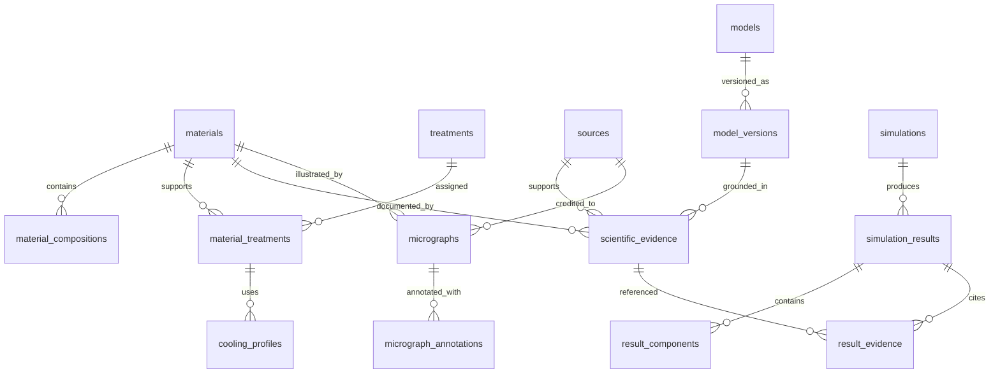

# FERROLAB — 05 Modelo de datos

**Estado:** especificación de implementación v2.0 · **Destino:** Claude Code · **Base:** PostgreSQL en Supabase

## 1. Objetivo y límites

El modelo guarda conocimiento metalúrgico **curado, versionado y trazable**, referencias de micrografías autorizadas, configuraciones de tratamiento, resultados deterministas y contenido educativo. El motor científico (FSE) ejecuta las fórmulas en Python; la base de datos **no calcula** resultados metalúrgicos. El usuario no necesita cuenta. El panel administrativo sí requiere autenticación y autorización.

**Materiales iniciales:** AISI 1045, AISI 8620, ASTM A48 Clase 30 (fundición gris; no tratar como acero). **Tratamientos:** temple, revenido, recocido, normalizado, austempering, martempering. Las combinaciones no necesariamente son válidas; cada pareja material-tratamiento debe evaluarse explícitamente.

## 2. Reglas científicas innegociables

1. Ninguna propiedad, porcentaje de fase, dureza, tamaño de grano o curva TTT/CCT se rellena con números ficticios. `NULL` y `not_supported` son resultados legítimos.
2. Distinguir `measured`, `literature`, `modeled`, `illustrative` y `unavailable`. Mostrar la clasificación al usuario.
3. Toda estimación lleva procedencia, versión del modelo, parámetros, supuestos, unidad, rango de validez y, cuando exista, incertidumbre. Una cita bibliográfica genérica no valida automáticamente un valor concreto.
4. El tamaño de pieza se ignora **solo como simplificación pedagógica**. La velocidad de enfriamiento, el medio fijo y las propiedades resultantes no deben presentarse como predicciones industriales exactas.
5. El medio de enfriamiento es **configuración bloqueada por material y tratamiento**, no editable por el estudiante. Para procesos escalonados, guardar un perfil de enfriamiento completo y no una etiqueta única.
6. El revenido depende del estado inicial (por ejemplo, una microestructura previamente templada). Si no hay estado anterior, exigir un estado inicial validado o marcar la simulación como no disponible.
7. Los aumentos 100×, 200×, 500× y 1000× solo se etiquetan como aumentos físicos cuando existen imágenes y calibraciones correspondientes. El zoom digital se indica como tal.
8. El modelo no convierte automáticamente ASTM E112, E562, E140 o A255 en predicciones sin mediciones y condiciones aplicables. No confundir normas de medición con modelos de simulación.

## 3. Mapa lógico



## 4. Tablas y campos principales

Los IDs son UUID, excepto catálogos de `materials` y `treatments` que usan códigos `text` estables como PK; las referencias a esos catálogos también son `text`. Todas las fechas se guardan como `timestamptz` UTC. Los campos `created_at`/`updated_at` son auditables.

| Tabla | Campos clave | Función |
|---|---|---|
| `materials` | `id` (PK text/código), `family`, `display_name`, `description_es`, `description_en`, `review_status`, `revision` | Catálogo de materiales; distinguir acero/fundición |
| `material_compositions` | `id`, `material_id`, `element`, `min_wt_pct`, `max_wt_pct`, `nominal_wt_pct`, `evidence_id` | Rangos composicionales; no suponer composición exacta de una probeta |
| `treatments` | `id` (PK text/código), `name_es`, `name_en`, `description_*` | Seis tratamientos |
| `material_treatments` | `id`, `material_id`, `treatment_id`, `compatibility_status`, `reason_es`, `reason_en`, `temperature_min_c`, `temperature_max_c`, `hold_min_s`, `hold_max_s`, `cooling_profile_id`, `initial_state_requirement`, `evidence_id`, `revision` | Compatibilidad y límites validados |
| `cooling_profiles` | `id`, `code`, `medium_name_es`, `medium_name_en`, `stages_json`, `source_id`, `review_status` | Medio fijo y trayectoria de enfriamiento simplificada |
| `sources` | `id`, `title`, `authors`, `year`, `publisher`, `doi`, `url`, `edition`, `pages`, `license_code`, `license_url`, `verification_status` | Referencias bibliográficas y licencias |
| `scientific_evidence` | `id`, `material_id`, `source_id`, `locator`, `claim`, `method`, `data_json`, `units_json`, `validity_json`, `uncertainty_json`, `review_status`, `reviewed_at` | Evidencia granular para parámetros y modelos |
| `models` | `id`, `code`, `name`, `description`, `domain` | Identidad del modelo científico |
| `model_versions` | `id`, `model_id`, `semver`, `git_commit`, `parameters_json`, `validity_json`, `approved`, `approved_at` | Reproducibilidad de cálculo |
| `micrographs` | `id`, `material_id`, `treatment_id`, `storage_path`, `source_id`, `license_code`, `attribution`, `magnification_x`, `scale_bar_um`, `pixel_size_um`, `preparation`, `imaging_method`, `conditions_json`, `match_quality`, `review_status` | Biblioteca visual autorizada |
| `micrograph_annotations` | `id`, `micrograph_id`, `phase_code`, `geometry_json`, `evidence_level`, `annotation_method`, `review_status` | Etiquetas de fases; nunca inventar segmentación |
| `simulations` | `id`, `anonymous_session_id`, `material_id`, `treatment_id`, `temperature_c`, `hold_s`, `initial_state_json`, `cooling_profile_id`, `request_hash`, `created_at` | Solicitud reproducible, opcionalmente persistida |
| `simulation_results` | `id`, `simulation_id`, `engine_version`, `simulation_status`, `result_json`, `assumptions_json`, `warnings_json`, `created_at` | Salida determinista con estado explícito |
| `result_components` | `id`, `result_id`, `quantity_code`, `value_numeric`, `unit`, `uncertainty_json`, `evidence_kind`, `evidence_level` | Fracciones, dureza, propiedades por separado |
| `result_evidence` | `result_id`, `evidence_id`, `usage` | Trazabilidad de cada resultado |
| `knowledge_entries` | `id`, `slug`, `language`, `title`, `body_md`, `source_id`, `review_status`, `revision` | Centro de conocimiento y glosario |
| `content_revisions` | `id`, `entity_type`, `entity_id`, `actor_id`, `before_json`, `after_json`, `created_at` | Auditoría de cambios administrativos |
| `app_events` | `id`, `anonymous_session_id`, `event_name`, `occurred_at`, `metadata_json` | Analítica agregada, sin identificación personal |

**Nota:** `material_treatments.cooling_profile_id` apunta a `cooling_profiles.id`; la relación puede ser nullable hasta completar la revisión científica. No se debe publicar una combinación **como calculable** si carece de configuración validada. Una entrada `educational_only` sí puede publicarse tras revisión editorial, con `quantitative_outputs_enabled=false` y una explicación explícita.

## 5. Contrato de resultado del FSE

El contrato JSON es versionado. Este ejemplo **no contiene valores metalúrgicos inventados**:

```json
{
  "request_id": "example-generated-id",
  "simulation_status": "insufficient_evidence",
  "dataset_version": "not-published-example",
  "protocol_version": null,
  "engine_version": "2.0.0",
  "model_version": null,
  "input": {
    "material_id": "aisi_1045",
    "treatment_id": "quench",
    "initial_condition_id": "example-condition-id",
    "target_temperature_c": 850,
    "hold_time_min": 30
  },
  "compatibility_status": "conditional",
  "protocol": null,
  "thermal_history": [],
  "results": {
    "phase_fractions": null,
    "microconstituent_fractions": null,
    "hardness": null,
    "grain_size": null,
    "mechanical_properties": null
  },
  "micrograph": null,
  "diagrams": [],
  "warnings": [
    {
      "code": "MISSING_VALIDATED_PROTOCOL",
      "message_key": "scientific.missing_protocol"
    }
  ],
  "evidence": [],
  "assumptions": [
    "Geometry omitted: educational simplification"
  ]
}
```

**Estados canónicos de simulación:** `completed`, `partial_result`, `insufficient_evidence`, `unsupported`, `invalid_input`, `internal_error`. **Niveles por propiedad:** `validated`, `bounded_estimate`, `qualitative`, `insufficient_evidence`, `unsupported`. La API usa el envelope común; la persistencia científica puede normalizar `results` en `result_components` sin cambiar el contrato JSON.

## 6. Diagrama de fases y curvas

Agregar tablas `diagram_sets` (`id`, `material_id`, `kind` TTT/CCT/Fe-C, `source_id`, `review_status`, `validity_json`) y `diagram_curves` (`id`, `diagram_set_id`, `curve_name`, `points_json`, `unit_x`, `unit_y`, `provenance`, `quality_status`). Los puntos deben ser datos digitalizados y verificados con permiso de uso, o datos de un modelo validado; jamás generar curvas con interpolación libre fuera de su dominio. Guardar si el eje de tiempo es logarítmico y la definición de cada curva.

## 7. Imágenes, derechos y atribución

**Flujo de ingestión:** registrar fuente → verificar licencia y condiciones → guardar metadatos y archivo permitido → revisión científica → publicar. No descargar ni redistribuir imágenes de libros protegidos sin licencia. RODARE CC BY 4.0: conservar atribución y cambios. NIST UHCS CC BY-SA 3.0: revisar obligaciones sobre derivados. Aachen-Heerlen: bloquear hasta aclarar licencia. MetalDAM: bloquear hasta resolver conflicto entre licencia del repositorio y publicación. UHCSDB: verificar la licencia específica de cada conjunto. Los datasets de otros aceros no son evidencia automática de una microestructura de 1045, 8620 o A48 Clase 30.

**Adaptación con IA:** únicamente para una **ilustración claramente etiquetada como sintética**, nunca como micrografía experimental ni como prueba de fases; no inventar límites de grano, escalas, porcentajes ni etiquetas. Preferir imágenes reales con condiciones documentadas. El zoom no revela detalle nuevo sin datos de mayor resolución.

## 8. Seguridad y privacidad

- **Público:** acceso de solo lectura a material científico `published`; no exponer tablas administrativas o borradores. Las operaciones de simulación se realizan por FastAPI con validación, rate limits y límites de consumo.
- **Administrador:** autenticación Supabase Auth, allowlist de ID y políticas RLS; MFA cuando esté disponible. Las claves `service_role` y las claves de proveedores de IA permanecen exclusivamente en servidor. Nunca incrustarlas en Flutter ni en el repositorio.
- **Storage:** bucket público solo para recursos publicados y autorizados; bucket privado para borradores. No confiar en ocultar URLs como mecanismo de autorización.
- **Analítica:** `anonymous_session_id` aleatorio, rotatorio, sin nombre, email ni IP persistida en tablas de eventos. Retención limitada y consentimiento/aviso según legislación aplicable. Usuarios conectados: métrica aproximada por sesiones activas, no personas identificadas.
- **Presupuesto:** no asumir que Supabase, hosting, generación de imágenes ni APIs de IA serán gratis indefinidamente. Configurar cuotas, caché, límites y apagado seguro del servicio de IA.

## 9. Migraciones y publicación de contenido

1. Crear migraciones SQL versionadas en `supabase/migrations/`; no editar esquemas de producción manualmente.
2. Cargar los tres materiales y seis tratamientos como **catálogo**, sin propiedades numéricas inventadas.
3. Marcar contenido `draft` hasta verificar evidencia y compatibilidad.
4. Validar referencias, rangos, unidades y restricciones de cada fila antes de `published`.
5. Publicar una revisión inmutable del contenido científico; cada resultado conserva `engine_version` y versión del conjunto de datos.
6. Las ediciones administrativas pasan por revisión, historial y rollback.

## 10. Índices, restricciones y consistencia

- `UNIQUE(materials.code)`, `UNIQUE(treatments.code)`, `UNIQUE(material_id,treatment_id)`.
- `CHECK(min_wt_pct >= 0 AND max_wt_pct <= 100 AND min_wt_pct <= max_wt_pct)` cuando ambos existen.
- `CHECK(temperature_min_c <= temperature_max_c)` y `CHECK(hold_min_s >= 0)` donde aplique.
- `CHECK(magnification_x > 0)` y `CHECK(scale_bar_um > 0)` si se informan.
- Fracciones calculadas en `result_components`: validar entre 0 y 100, y suma aproximadamente 100 **solo si** se declara un conjunto completo de fases mutuamente excluyentes. No sumar constituyentes superpuestos.
- Índices en `material_treatments(material_id,treatment_id)`, `micrographs(material_id,treatment_id,review_status)`, `simulations(request_hash)` y `app_events(occurred_at,event_name)`.
- Usar JSONB solo para parámetros heterogéneos; campos consultados o validados con frecuencia deben tener columnas tipadas.

## 11. Operación sin cuentas de estudiante

El historial y favoritos viven **localmente en Flutter** por defecto. Persistir una simulación en Supabase es opcional y solo si aporta valor; evitar acumular resultados duplicados. El modo profesor puede exportar un código de práctica que codifique un identificador aleatorio de configuración, sin cuentas. Los estudiantes reciben la misma configuración y la misma versión del motor.

## 12. Criterios de aceptación para Claude Code

- [ ] Esquema creado con migraciones reproducibles y seeds sin cifras científicas inventadas.
- [ ] Catálogo de 3 materiales y 6 tratamientos; combinaciones marcadas como `draft`, `supported` o `unsupported` según evidencia.
- [ ] RLS: un cliente anónimo no puede escribir, borrar ni leer borradores.
- [ ] Administración autenticada y auditada; claves secretas fuera del cliente.
- [ ] Cada resultado conserva versión, entrada, supuestos, estado y referencias verificables.
- [ ] No se publica una imagen sin licencia comprobada, metadatos y atribución.
- [ ] Las consultas devuelven estados explícitos ante datos incompletos.
- [ ] Pruebas de integridad, migración, permisos, unidades y rangos pasan en CI.
- [ ] Documentación de instalación y rollback accesible para un administrador no programador.

## 13. Instrucciones para Claude Code

Implementar primero migraciones y validadores, luego seeds mínimos, repositorios de acceso y pruebas. No generar datos de dureza, porcentajes, diagramas ni micrografías ficticias para simular completitud. Si falta información, crear una tarea científica pendiente y mostrar el estado correspondiente. Mantener compatibilidad con `03_Arquitectura_Software.md`, `04_Motor_Cientifico_FSE.md` y el futuro `06_Backend_FastAPI.md`; documentar cualquier conflicto antes de codificar.

---

## 14. Anexo v2 — diseño físico y normalización

### 14.1 Convenciones canónicas

- PostgreSQL con IDs `uuid` generados en servidor; catálogos estáticos conservan `code text` estable y único.
- `numeric` o `double precision` con semántica documentada para medidas; almacenar unidades separadas, **nunca** «58 HRC» como valor de texto indistinto.
- JSONB solo para estructuras científicas que exigen variación controlada (`thermal_stages`, `validity_domain`); usar columnas/FK para entidades de identidad y permisos.
- Toda entidad publicable conserva `review_status`, `created_at`, `updated_at`, `reviewed_by`, `published_at` y una versión reproducible.
- Traducciones: dos campos `*_es`/`*_en` para términos pequeños; `knowledge_translations` para contenido largo. No duplicar la entidad científica al traducir.
- Evitar guardar identificadores personales anónimos en `simulations`: P0 calcula sin persistencia; si se necesita idempotencia temporal usar hash no reversible con TTL y sin fingerprint del dispositivo.

### 14.2 DDL ilustrativo de núcleo de catálogo

**Fragmento de arranque, NO migración completa:** las demás tablas deben definirse con Alembic respetando las relaciones del apartado 4. El código siguiente ejemplifica tipos y checks, no autoriza datos científicos.

```sql
create extension if not exists pgcrypto;

create table if not exists materials (
  id text primary key,
  display_name text not null,
  family text not null check (family in ('steel','gray_cast_iron')),
  description_es text not null,
  description_en text not null,
  review_status text not null default 'draft'
    check (review_status in ('draft','reviewed','published','retired')),
  created_at timestamptz not null default now()
);

create table if not exists treatments (
  id text primary key,
  name_es text not null,
  name_en text not null,
  description_es text not null,
  description_en text not null
);

create table if not exists cooling_profiles (
  id uuid primary key default gen_random_uuid(),
  code text not null unique,
  stages_json jsonb not null check (jsonb_typeof(stages_json) = 'array'),
  medium_es text not null,
  medium_en text not null,
  source_id uuid,
  review_status text not null default 'draft'
);

create table if not exists material_treatments (
  id uuid primary key default gen_random_uuid(),
  material_id text not null references materials(id),
  treatment_id text not null references treatments(id),
  initial_condition_id uuid,
  compatibility_status text not null check (
    compatibility_status in ('supported','conditional','educational_only','unsupported')
  ),
  reason_es text not null,
  reason_en text not null,
  temperature_min_c numeric,
  temperature_max_c numeric,
  hold_min_s numeric,
  hold_max_s numeric,
  cooling_profile_id uuid references cooling_profiles(id),
  protocol_version text not null,
  quantitative_outputs_enabled boolean not null default false,
  review_status text not null default 'draft',
  constraint valid_temperature_bounds check (
    temperature_min_c is null or temperature_max_c is null
    or temperature_min_c <= temperature_max_c
  ),
  constraint valid_time_bounds check (
    hold_min_s is null or hold_max_s is null or hold_min_s <= hold_max_s
  ),
  unique (material_id, treatment_id, initial_condition_id, protocol_version)
);
```

**Nota sobre `UNIQUE` con `NULL`:** PostgreSQL normalmente permite varias filas con NULL en columnas incluidas en una restricción unique; si `initial_condition_id` es opcional, migrar a `NULLS NOT DISTINCT` donde la versión lo permita o usar índice único por expresión. El diseño final requiere `FOREIGN KEY` hacia tabla `initial_conditions` tras crearla. El seed debe incluir nombres/taxonomía, no curvas/durezas ficticias.

### 14.3 Tablas adicionales imprescindibles

| Tabla | Clave y vínculos | Invariante |
|---|---|---|
| `dataset_releases` | `id`, `semantic_version`, `checksum`, `published_at`, `reviewed_by` | Inmutable tras publicación. |
| `initial_conditions` | `id`, `material_id`, `source_id`, `description`, `state_json`, `review_status` | Registrar si 8620 está cementado y matriz/grafito de A48. |
| `protocol_stages` | `protocol_id`, `ordinal`, `kind`, `params_json`, `evidence_id` | Secuencia válida y explícita. |
| `model_versions` | `model_id`, `version`, `equation_ref`, `domain_json`, `source_id` | Sin ecuación o rango comprobado, deshabilitado. |
| `evidence_records` | `id`, `source_id`, `locator`, `data_hash`, `units_json`, `license_status` | Fuente concreta, no título genérico. |
| `result_facts` | `result_id`, `quantity`, `value`, `unit`, `evidence_kind`, `evidence_id` | Cada cifra enlaza a evidencia o modelo validado. |
| `admin_memberships` | `user_id`, `role`, `status` | Roles server-checked; evitar confiar en `role` del body. |
| `audit_log` | `id`, `actor_id`, `action`, `entity_id`, `before`, `after`, `ts` | Append-only y acceso admin. |
| `media_license_reviews` | `micrograph_id`, `license_url`, `verified_by`, `verified_at`, `notes` | Activo no visible sin revisión afirmativa. |

**Unificar nombres finales con el apartado 4** antes de migrar: `scientific_evidence` puede ser la tabla física correspondiente a `evidence_records`; `result_components` puede corresponder a `result_facts`. No crear dos tablas redundantes por haber dos nombres conceptuales. El contrato final debe quedar en los modelos SQLAlchemy/migraciones y en el OpenAPI.

### 14.4 Políticas de acceso — diseño esperado

**Recomendación para P0:** cliente Flutter consume FastAPI; conexiones a Supabase ocurren **desde backend**. Por defecto, no conceder lectura directa a tablas desde `anon`. Si se exponen tablas de solo lectura en el futuro, habilitar RLS y políticas `SELECT` que permitan **solo filas publicadas y columnas seguras a través de vistas específicas**; recordar que RLS filtra filas, no columnas. Administradores se autentican por Supabase Auth, pero permisos CRUD y aprobación se revalidan en servidor y se restringen por rol. Nunca exponer tablas de auditoría, borradores, instrucciones de revisión ni credenciales de proveedores.

**Ejemplo de política restrictiva** (adaptar al patrón real de acceso):

```sql
alter table materials enable row level security;
-- Sin política pública, el rol anon no puede leer ni escribir esta tabla.
-- FastAPI obtiene información pública por una consulta controlada del servidor.
revoke all on table materials from anon;
```

Probar con identidades `anon`, `authenticated` no-admin, `editor`, `reviewer` y `admin`, verificando **SELECT/INSERT/UPDATE/DELETE**. No aceptar como seguridad solo «se oculta el botón del admin».

### 14.5 Ingesta de micrografías y diagramas

Pasos transaccionales: registrar `source` → verificar URL/licencia por archivo → capturar metadatos del espécimen → subir archivo a área privada de revisión → calcular SHA-256 → revisar correspondencia científica → publicar referencia y derivado permitido → ofrecer enlace y atribución. Eliminar/revocar una licencia debe retirar el activo de catálogo y generar evento de auditoría. No usar datasets de aceros UHCS como sustituto de AISI 1045 sin advertencia y permiso.

### 14.6 Dataset release como snapshot

`dataset_releases` fija IDs/versiones de `materials`, `material_treatments`, `cooling_profiles`, `models`, `evidence_records`, `diagram_sets` y `micrographs` visibles en la simulación. Para un mismo hash de input canónico, `dataset_version`, `protocol_version`, `engine_version` y `model_version` deben producir resultados equivalentes. Una corrección científica publica **nueva versión** en vez de modificar silenciosamente el historial.

### 14.7 Checklist de migración

- [ ] Todas las FK, índices únicos y CHECK validan correctamente.
- [ ] Las referencias de evidencia no quedan huérfanas.
- [ ] Las pruebas de RLS demuestran **denegación por defecto**.
- [ ] El catálogo inicial contiene 3 materiales y 6 tratamientos **sin magnitudes inventadas**.
- [ ] Se puede aprobar/publicar/revertir un dataset con auditoría.
- [ ] Se rechaza un resultado con cifra y `source_ids=[]`.
- [ ] Revisión legal de los campos de licencia antes de servir imágenes.
