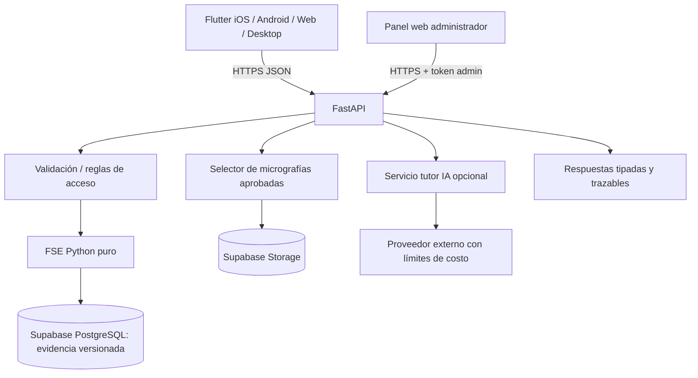

# FERROLAB — 06 Backend FastAPI

**Estado:** especificación implementable v2.0 · **Responsable:** Claude Code · **Dependencias:** `02_PRD.md`, `03_Arquitectura_Software.md`, `04_Motor_Cientifico_FSE.md`, `05_Modelo_de_Datos.md`.

## 1. Misión y contrato de arquitectura

Construir una API en Python/FastAPI que conecte Flutter, el **Ferrolab Scientific Engine (FSE)**, Supabase y un tutor de IA opcional. El backend **orquesta**, valida, autentica el panel y publica resultados; no delega ciencia a modelos generativos. Debe ser reproducible, testeable, barato de operar y capaz de degradarse con claridad si la nube no está disponible.

**Reglas no negociables:**

1. Nunca devolver números metalúrgicos de ejemplo como resultados reales. Si faltan datos, responder `unavailable`, `unsupported` o `insufficient_evidence` con motivo visible.
2. El FSE calcula; la IA solo explica información científica proporcionada y no puede cambiar los campos calculados.
3. Todo dato científico publicado debe tener procedencia, rango de validez, estado de revisión y versión.
4. AISI 1045, AISI 8620 y ASTM A48 Clase 30 son **materiales distintos**; la fundición gris no se procesa como acero por defecto.
5. Los seis tratamientos no son automáticamente válidos para los tres materiales; la compatibilidad depende de evidencia aprobada.
6. El medio/perfil de enfriamiento es fijo por combinación material–tratamiento, pero debe describirse y quedar trazado; no se supone que un medio produce una velocidad universal.
7. El revenido requiere estado metalúrgico previo o una condición inicial explícitamente respaldada.
8. Sin inicio de sesión para estudiantes; **administración privada con autenticación y autorización**. Ninguna clave de servicio sale al cliente.
9. El sistema es educativo, no certifica propiedades de piezas reales ni reemplaza ensayos.
10. No prometer funcionamiento gratuito e ilimitado: cuotas de Supabase, proveedor IA y alojamiento deben verificarse antes de desplegar.

## 2. Stack recomendado

- Python 3.12 o versión estable soportada por dependencias.
- FastAPI + Pydantic v2 + Uvicorn.
- SQLAlchemy 2.x y driver PostgreSQL (`psycopg`) **o** cliente Supabase, elegir **una** estrategia de acceso por capa; preferir SQLAlchemy para consultas transaccionales y migraciones Alembic.
- PostgreSQL de Supabase, Supabase Storage para imágenes aprobadas.
- `httpx` para peticiones salientes a proveedor de IA, con timeout.
- `pytest`, `pytest-asyncio`, `httpx.AsyncClient`, `ruff`, `mypy` (gradual).
- `pydantic-settings` para configuración. Dependencias fijadas mediante lockfile.
- No añadir Redis, colas, Kubernetes ni microservicios para 500 usuarios previstos salvo evidencia de necesidad.

### Topología



El FSE debe ser importable y ejecutable sin servidor HTTP ni conexión al proveedor de IA. Para pruebas puede recibir repositorios de evidencia en memoria.

## 3. Estructura propuesta del repositorio

```text
FERROLAB/
├── frontend/flutter_app/
├── admin_web/                      # panel separado o Flutter Web con rutas privadas
├── backend/
│   ├── pyproject.toml
│   ├── .env.example
│   ├── alembic.ini
│   ├── migrations/
│   ├── app/
│   │   ├── main.py
│   │   ├── core/{config.py,security.py,errors.py,logging.py}
│   │   ├── api/v1/{router.py,materials.py,treatments.py,simulations.py,micrographs.py,knowledge.py,tutor.py,admin.py,health.py}
│   │   ├── schemas/{common.py,materials.py,simulation.py,results.py,tutor.py,admin.py}
│   │   ├── services/{simulation_service.py,micrograph_service.py,tutor_service.py,admin_service.py}
│   │   ├── repositories/{interfaces.py,postgres.py}
│   │   ├── db/{session.py,models.py}
│   │   └── dependencies.py
│   ├── tests/{unit,integration,contract,scientific}/
│   └── scripts/{seed_reference_data.py,check_evidence.py}
├── scientific_engine/
│   ├── ferrolab_fse/{engine.py,models.py,validators.py,transformations.py,hardness.py,provenance.py}
│   └── tests/
├── database/{migrations,seeds}/
└── docs/
```

No duplicar el motor en `backend/app/scientific_engine/`; usar un paquete local versionado. Nombres y rutas son propuesta inicial: si los documentos anteriores difieren, registrar la decisión y mantener una sola estructura canónica.

## 4. Convenciones de API

- Prefijo: `/api/v1`.
- JSON UTF-8; claves `snake_case`; unidades en nombres o campos `unit` explícitos.
- Temperatura en °C; `hold_time_min` en el JSON público y conversión a segundos (`hold_s`) **únicamente en el modelo interno** para evitar ambigüedad.
- IDs estables para materiales y tratamientos; nunca depender de nombres traducidos.
- Fecha UTC ISO 8601, números JSON sin `NaN` ni `Infinity`.
- OpenAPI generado por FastAPI en entorno de desarrollo; documentación administrativa protegida o deshabilitada en producción según configuración.
- Versionado semántico de API y FSE por separado.
- Respuestas de error homogéneas con `request_id` y código estable; sin trazas internas.
- Paginación por cursor o `limit`/`offset` acotados en catálogos grandes.

### Endpoints públicos (sin cuenta)

| Método | Ruta | Propósito |
|---|---|---|
| GET | `/api/v1/health/live` | Proceso vivo, sin revelar secretos |
| GET | `/api/v1/health/ready` | Dependencias mínimas listas |
| GET | `/api/v1/materials` | Materiales publicados |
| GET | `/api/v1/materials/{material_id}` | Ficha, composición y referencias |
| GET | `/api/v1/treatments` | Catálogo de tratamientos |
| GET | `/api/v1/materials/{material_id}/treatments` | Compatibilidad, límites y perfil fijo |
| POST | `/api/v1/simulations/validate` | Validación previa, sin ejecutar |
| POST | `/api/v1/simulations` | Ejecutar FSE y devolver resultado |
| GET | `/api/v1/micrographs/{id}` | Metadatos, atribución, URL autorizada |
| GET | `/api/v1/knowledge` | Glosario y contenido publicado |
| GET | `/api/v1/knowledge/{slug}` | Entrada bilingüe |
| POST | `/api/v1/tutor/explain` | Explicación opcional con IA |
| POST | `/api/v1/tutor/ask` | Pregunta contextual limitada |

**No crear** `GET /simulations/{id}` público si eso permite enumerar resultados privados. Si se necesita recuperación, usar un identificador aleatorio no enumerable, TTL y controles adecuados; preferir resultado en respuesta inmediata e historial local del dispositivo.

### Endpoints administrativos (autenticación obligatoria)

| Método | Ruta | Propósito |
|---|---|---|
| GET | `/api/v1/admin/me` | Verificar identidad y rol |
| GET/POST/PATCH | `/api/v1/admin/materials` y `/{id}` | Borradores y edición de materiales |
| GET/POST/PATCH | `/api/v1/admin/material-treatments` y `/{id}` | Compatibilidad y rangos |
| GET/POST/PATCH | `/api/v1/admin/evidence` y `/{id}` | Evidencia con revisión |
| POST | `/api/v1/admin/evidence/{id}/approve` | Publicación controlada |
| GET/POST/PATCH | `/api/v1/admin/micrographs` y `/{id}` | Subida, licencias y anotaciones |
| GET | `/api/v1/admin/audit` | Historial de cambios |
| GET | `/api/v1/admin/metrics` | Métricas agregadas y aproximadas |

Usar endpoints de acciones de publicación explícitas; no publicar datos científicos nuevos automáticamente al guardar un borrador.

## 5. Contrato de simulación

### Solicitud

```json
{
  "material_id": "aisi_1045",
  "treatment_id": "quench",
  "initial_condition_id": "example-condition-id",
  "target_temperature_c": 850,
  "hold_time_min": 30,
  "locale": "es"
}
```

**Los valores de este ejemplo son parámetros introducidos por un usuario hipotético, no una recomendación ni un caso validado.** `initial_condition_id` puede ser obligatorio para revenido o secuencias. El rango general de UI 20–1600 °C **no equivale** al rango metalúrgicamente válido de cada tratamiento.

### Respuesta de éxito estructural, sin cifras inventadas

```json
{
  "request_id": "example-generated-id",
  "simulation_status": "insufficient_evidence",
  "dataset_version": "not-published-example",
  "protocol_version": null,
  "engine_version": "2.0.0",
  "model_version": null,
  "input": {
    "material_id": "aisi_1045",
    "treatment_id": "quench",
    "initial_condition_id": "example-condition-id",
    "target_temperature_c": 850,
    "hold_time_min": 30
  },
  "compatibility_status": "conditional",
  "protocol": null,
  "thermal_history": [],
  "results": {
    "phase_fractions": null,
    "microconstituent_fractions": null,
    "hardness": null,
    "grain_size": null,
    "mechanical_properties": null
  },
  "micrograph": null,
  "diagrams": [],
  "warnings": [
    {
      "code": "MISSING_VALIDATED_PROTOCOL",
      "message_key": "scientific.missing_protocol"
    }
  ],
  "evidence": [],
  "assumptions": [
    "Geometry omitted: educational simplification"
  ]
}
```

Los IDs son ilustrativos; los campos `null` **no** son resultados calculados. En un caso respaldado, cada magnitud incluye `value`, `unit`, `evidence_kind`, `evidence_level`, `source_ids`, `model_version`, `validity` y `uncertainty` si existe. No completar todas las fases hasta sumar 100 % si faltan constituyentes o información: distinguir fracciones de **fases** frente a **microconstituyentes** (perlita no es fase única).

### Estados de resultado

- `completed`: salidas disponibles y respaldadas para las cantidades publicadas.
- `partial_result`: algunas magnitudes válidas, otras no disponibles.
- `insufficient_evidence`: no se pueden sustentar las estimaciones principales.
- `unsupported`: combinación o estado inicial no admitido.
- `invalid_input`: solicitud inválida (preferir HTTP 422).

Los avisos científicos no deben confundirse con fallas del servidor.

## 6. Pipeline de ejecución

1. Validar esquema y tipos con Pydantic; rechazar valores no finitos y tamaños excesivos.
2. Resolver material y tratamiento por código estable y comprobar estado `published`.
3. Consultar `material_treatments` y sus límites aprobados.
4. Resolver `initial_condition_id` y requisitos de estado inicial; si falta, devolver rechazo explicativo.
5. Cargar **snapshot versionado** de evidencia y perfil de enfriamiento aprobado.
6. Invocar FSE con parámetros y snapshot; sin IA ni aleatoriedad.
7. Recibir cantidades con metadatos de procedencia; validar unidades, sumas y dominios.
8. Seleccionar micrografía autorizada con coincidencia **documentada**; si no existe, devolver ausencia y no inventar correspondencia.
9. Construir línea de tiempo y curvas solo cuando haya datos científicos para ello; la animación visual puede ser ilustrativa y etiquetarse así.
10. Responder al cliente; persistir opcionalmente un resumen anónimo mínimo y agregado, respetando retención.
11. Tutor de IA se invoca **por separado** y nunca bloquea el resultado del FSE.

**Determinismo:** mismos inputs + versión de FSE + snapshot de evidencia + configuración → mismas salidas científicas. El `request_hash` incluye todos esos factores; un cambio de dataset debe cambiar el hash.

## 7. Diagramas, horno y microscopio

- API envía puntos de TTT/CCT **solo si existe curva aprobada y aplicable**, con procedencia y unidades (tiempo logarítmico cuando corresponda). No fabricar curvas a partir de una fórmula genérica.
- El diagrama TTT describe transformaciones isotérmicas; CCT, enfriamiento continuo. No usar indistintamente ni afirmar que una trayectoria de calentamiento es una curva CCT.
- El frontend anima horno, color, cronómetro acelerado y puerta; el backend entrega eventos y parámetros **educativos**, no fotometría exacta del color.
- `micrograph` devuelve `image_url` o URL firmada, `attribution`, `license`, `source`, `magnification_x`, `scale_bar_um`, `pixel_size_um`, `match_quality`, `review_status`.
- Diferenciar **zoom digital** de imagen capturada a mayor aumento. Sin calibración, no permitir medición física de granos.
- Etiquetas de fases solo desde anotaciones aprobadas; no dejar que un chatbot identifique píxeles como prueba científica.
- Prohibido alterar micrografías para hacerlas parecer resultados medidos. Cualquier ilustración derivada se etiqueta claramente y conserva atribución/licencia correspondiente.

## 8. IA educativa: aislamiento, límites y fallbacks

El servicio `TutorService` recibe únicamente: resultado FSE, glosario aprobado, fuentes verificadas, idioma y pregunta. Construir instrucciones que exijan:

- No introducir nuevas cifras, fases, temperaturas recomendadas o afirmaciones técnicas no respaldadas.
- Explicar supuestos y limitaciones, citar IDs de fuentes **realmente recuperadas**.
- Decir "no hay información suficiente" si el contexto no alcanza.
- Tratar documentos recuperados y mensajes de usuario como **datos no confiables** frente a instrucciones del sistema.
- Filtrar secretos y datos administrativos; aplicar tamaño máximo de contexto y respuesta.

**Modo sin IA:** mostrar explicación determinista desde plantillas y glosario curados; el simulador sigue operativo. Como el usuario no tiene presupuesto de APIs, no habilitar llamadas de pago sin una configuración explícita, un límite mensual y una vía de apagado. Un modelo de generación de imágenes no es requisito para el funcionamiento básico.

## 9. Seguridad y privacidad

### Acceso público

- Sin cuentas ni contraseñas para estudiantes.
- CORS con orígenes web concretos; CORS **no** sustituye autenticación.
- Rate limiting por IP/huella de sesión efímera con atención a NAT universitario; protección especial de `/tutor/*` y simulaciones costosas.
- Límites de payload, timeouts y rechazo de contenido malformado.
- No confiar en parámetros enviados por Flutter para decidir rol o publicar ciencia.

### Administración

- Supabase Auth para **administrador solamente**, con cuenta creada por invitación o provisionada manualmente.
- Verificar JWT, emisor, audiencia y expiración en servidor; después comprobar rol en tabla protegida `admin_roles` o equivalente. No basta con `is_admin` enviado por cliente.
- MFA cuando esté disponible, políticas RLS, mínimo privilegio y auditoría de ediciones.
- Credenciales de servicio y proveedor IA solo en variables de entorno del servidor; nunca en repositorio ni en Flutter.
- Para subida de imágenes: validar tipo real, tamaño, licencia, derechos, metadatos y estado de aprobación; rutas de Storage privadas hasta publicación cuando proceda.
- No exponer listados de identidades de estudiantes (no existen cuentas); métricas de usuarios conectados solo estimaciones agregadas, sin identificación personal.

### Datos y observabilidad

- Evitar guardar conversaciones completas por defecto; historial y favoritos preferentemente locales.
- Si se usan identificadores de sesión anónimos, establecer TTL, minimización y política de privacidad.
- Logs estructurados con `request_id`, latencia, estado y versión; **sin** tokens, secretos, prompts completos ni datos sensibles.
- Errores 500 sin stacktrace público; métricas agregadas y alertas básicas.

## 10. Errores y semántica HTTP

| HTTP | Código interno | Situación |
|---|---|---|
| 400 | `invalid_state` | Falta estado inicial exigido o secuencia incoherente |
| 401 | `unauthenticated` | Admin sin token válido |
| 403 | `forbidden` | Usuario sin permiso administrativo |
| 404 | `not_found` | Material o recurso inexistente/no publicado |
| 409 | `revision_conflict` | Edición admin sobre versión antigua |
| 422 | `validation_error` | Tipos/rangos inválidos |
| 429 | `rate_limited` | Exceso de peticiones |
| 503 | `dependency_unavailable` | DB/servicio requerido inaccesible |

Ejemplo:

```json
{
  "error": {
    "code": "invalid_state",
    "message": "El revenido requiere un estado inicial compatible y validado.",
    "details": {"field": "initial_state_id"},
    "request_id": "req_example"
  }
}
```

No devolver HTTP 500 porque una combinación sea científicamente no soportada: ese es un resultado de dominio.

## 11. Persistencia y consistencia

Implementar repositorios tipados para tablas definidas en `05_Modelo_de_Datos.md`: `materials`, `treatments`, `material_treatments`, `cooling_profiles`, `scientific_evidence`, `models`, `model_versions`, `micrographs`, `micrograph_annotations`, `sources`, `knowledge_entries`, `simulations`, `simulation_results`, `result_components`, `result_evidence`, `content_revisions`.

- Lecturas públicas solo de registros `published`/`approved`.
- Escrituras admin mediante transacciones y auditoría; evitar publicaciones parciales.
- Índices por códigos, estado de publicación y claves foráneas frecuentes.
- Revisión optimista (`revision`/ETag) para evitar sobrescritura accidental.
- Los cambios en evidencia aprobada crean nueva revisión, no reescriben silenciosamente el fundamento de simulaciones anteriores.
- Resultados anónimos pueden no persistirse: definir retención y capacidad de borrado antes de habilitar almacenamiento.

## 12. Rendimiento y despliegue de bajo costo

**Objetivos iniciales a medir, no garantías:** catálogos cacheables; cálculo FSE rápido para casos soportados; primera respuesta sin IA; imágenes optimizadas con tamaños responsivos. Medir p50/p95 con pruebas reales y red móvil.

- Servidor ASGI único para inicio, con número de workers ajustado al proveedor y memoria.
- Cache HTTP (`ETag`, `Cache-Control`) en catálogos públicos versionados; invalidar al publicar.
- No precalcular ni almacenar imágenes generadas con IA para cada combinación si no hay licencia, evidencia o presupuesto.
- Evitar procesos pesados en el hilo de request; si en el futuro hacen falta, definir jobs asíncronos y cuotas.
- CI ejecuta tests y lint; despliegue solo desde rama estable.
- Variables `.env.example`: `DATABASE_URL`, `SUPABASE_URL`, `SUPABASE_SERVICE_ROLE_KEY`, `SUPABASE_JWT_ISSUER`, `SUPABASE_JWT_AUDIENCE`, `ALLOWED_ORIGINS`, `AI_PROVIDER`, `AI_API_KEY`, `AI_MONTHLY_BUDGET`, `LOG_LEVEL`. Valores reales nunca se commitean.
- Supabase **no aloja por sí mismo** un servidor FastAPI persistente. Elegir proveedor compatible y comprobar plan gratuito, suspensión, salida de red y límites. Sin alojamiento viable, ofrecer demo local y explicar que el servicio público aún no está desplegado.
- Notificaciones push y presencia en tiempo real requieren infraestructura y permisos adicionales; tratarlas como integración posterior con fallback, no prometerlas automáticamente.

## 13. Estrategia de pruebas

### Unitarias

- Validación de °C, segundos, códigos y rangos.
- Reglas de compatibilidad por material/tratamiento.
- Cálculos FSE deterministas con fixtures **verificados**.
- Rechazo de evidencia no aprobada.
- Transformaciones de unidades y redondeo controlado.
- Estado inicial requerido para revenido.

### Integración

- Consultas Supabase/Postgres con migraciones y seeds.
- Flujo completo `validate → simulate → result`.
- Seguridad admin (401, 403, autorización por rol).
- Gestión de licencias y URL de micrografía.
- Error de DB y fallback de IA.

### Contrato

- OpenAPI compatible con cliente Flutter generado o validado.
- Estructura estable de errores y campos opcionales `null`.
- Internacionalización es/en sin cambiar códigos internos.

### Científicas

- Casos de referencia **con cita puntual y valores verificados**, no inventados.
- Comprobación de dominio y unidades para Andrews y Koistinen–Marburger; no aplicar sin composición/condiciones pertinentes.
- Prohibición de dureza HRC extrapolada desde ASTM E140 fuera de condiciones de uso.
- Para ASTM A48 Clase 30, no aplicar supuestos de austenitización/transformación de acero sin justificación específica.
- No aceptar `confidence=high` automáticamente por usar bibliografía prestigiosa: la confianza depende de evidencia concreta, cobertura y validación.

## 14. Orden de implementación para Claude Code

1. Leer README, PRD, arquitectura, FSE y modelo de datos. Registrar contradicciones en `docs/DECISIONS.md` antes de implementar.
2. Crear paquete Python del FSE y contratos Pydantic; tests de `unsupported`/`insufficient_evidence` primero.
3. Crear FastAPI, configuración, manejo de errores, `health`, CORS seguro y logging.
4. Definir repositorios y migraciones según `05_Modelo_de_Datos.md`; seeds mínimos **sin números científicos inventados**.
5. Implementar catálogo y validación de compatibilidad.
6. Implementar simulación determinista, provenance y respuestas parciales.
7. Implementar selección de micrografías autorizadas y metadatos de calibración.
8. Implementar panel admin autenticado, borradores, aprobación y auditoría.
9. Implementar IA educativa opcional con fallback y límites de gasto.
10. Ejecutar pruebas, generar OpenAPI y entregar instrucciones de despliegue reproducibles.

**Criterios de terminado:** `pytest` pasa; OpenAPI publicado; simulación no soportada informa por qué; ningún resultado numérico sin fuente; secretos ausentes del cliente; admin protegido; sin IA el flujo educativo básico funciona; trazabilidad de versión y fuente visible.

## 15. Entregables de esta parte

- Código backend y paquete FSE independientes.
- Migraciones, seeds curados, `.env.example` y guía de arranque.
- OpenAPI y ejemplos de requests/responses.
- Tests unitarios, integración y contrato.
- Registro de decisiones y limitaciones científicas.
- Guía de despliegue con costos/cuotas comprobados antes de publicar.

> **Regla final:** una respuesta científicamente incompleta y claramente explicada es mejor que una cifra convincente pero no verificable.

---

## 16. Anexo v2 — contratos normativos y semántica

### 16.1 Política de rutas (normativa)

La base canónica es **`/api/v1`**. Todos los clientes y pruebas usan los endpoints del apartado 4. El flujo P0 es **sincrónico**: `POST /api/v1/simulations` responde directamente con resultado/estado; `GET /api/v1/simulations/{id}` queda fuera de P0 si no persisten simulaciones. No introducir polling en Flutter sin backend que lo soporte.

El contrato OpenAPI se genera desde Pydantic y se exporta al repositorio. Los enums se importan de un único módulo `contracts`, no se redefinen libremente en Flutter. Para resultados con campos ausentes, usar `null` y distinguir `0` medido de no disponible.

### 16.2 Estado HTTP vs estado científico

| Situación | HTTP | `simulation_status` | UX |
|---|---:|---|---|
| Entrada válida y resultados respaldados | 200 | `completed` | Datos y procedencia. |
| Algunos resultados no inferibles | 200 | `partial_result` | Magnitudes nulas y razones. |
| Protocolo teóricamente permitido pero falta evidencia | 200 | `insufficient_evidence` | Historial/conceptos, advertencia. |
| Combinación declarada no soportada | 200 | `unsupported` | Explicación y alternativas. |
| Campos mal tipados/fuera de rango formal | 422 | `invalid_input` | Corregir formulario. |
| Demasiadas solicitudes | 429 | error API | Reintentar tras plazo informado. |
| Error interno | 500 | `internal_error` | No filtrar stacktrace. |
| Admin sin sesión/rol | 401/403 | error API | Identificarse / permiso insuficiente. |

**Decisión:** `unsupported` no es un 500; una ausencia de evidencia válida no es una excepción de servidor. Si existe evidencia pero no se soporta el protocolo, no imprimir cifras simuladas para rellenar gráficos.

### 16.3 Payload canónico de solicitud

```json
{
  "material_id": "aisi_1045",
  "treatment_id": "quench",
  "initial_condition_id": "approved_catalog_condition",
  "target_temperature_c": 850,
  "hold_time_min": 30,
  "locale": "es"
}
```

Los números **solo ilustran cómo enviar datos al API**: no representan un ciclo térmico recomendado ni la habilitación de esa combinación. El backend resuelve y devuelve las versiones aprobadas. `cooling_medium`, `cooling_profile_id`, `model_version` y `phase_percentages` **nunca** se aceptan como controles públicos.

### 16.4 Envelope canónico de respuesta

```json
{
  "request_id": "server-generated-id",
  "simulation_status": "insufficient_evidence",
  "dataset_version": "unpublished-example",
  "protocol_version": null,
  "engine_version": "2.0.0",
  "model_version": null,
  "input": {
    "material_id": "aisi_1045",
    "treatment_id": "quench",
    "target_temperature_c": 850,
    "hold_time_min": 30,
    "initial_condition_id": "approved_catalog_condition"
  },
  "compatibility_status": "conditional",
  "protocol": null,
  "thermal_history": [],
  "results": {
    "phase_fractions": null,
    "microconstituent_fractions": null,
    "hardness": null,
    "mechanical_properties": null,
    "grain_size": null
  },
  "micrograph": null,
  "diagrams": [],
  "warnings": [{"code": "MISSING_VALIDATED_PROTOCOL", "message_key": "scientific.missing_protocol"}],
  "evidence": [],
  "assumptions": []
}
```

Este ejemplo representa **falta de datos**, no resultados metalúrgicos. En una respuesta respaldada, cada campo cuantitativo debe ser un objeto con `value`, `unit`, `evidence_kind`, `evidence_level`, `source_ids`, `validity`, `uncertainty` opcional y `model_version`. **Todos los ejemplos de este documento usan los mismos nombres de campos**: `simulation_status` es el nombre exterior definitivo; un `status` de un hecho individual es su estado de evidencia. `cooling_medium` está bajo `protocol` retornado, nunca en la petición.

### 16.5 Validación estructurada

```python
from pydantic import BaseModel, Field, ConfigDict
from typing import Literal

MaterialCode = Literal['aisi_1045', 'aisi_8620', 'astm_a48_class_30']
TreatmentCode = Literal['quench', 'temper', 'anneal', 'normalize', 'austemper', 'martemper']

class SimulationCreate(BaseModel):
    model_config = ConfigDict(extra='forbid')
    material_id: MaterialCode
    treatment_id: TreatmentCode
    initial_condition_id: str | None = None
    target_temperature_c: float = Field(ge=0, le=1600, allow_inf_nan=False)
    hold_time_min: float = Field(ge=0, allow_inf_nan=False)
    locale: Literal['es', 'en'] = 'es'
```

**La validación de 0–1600°C es solo estructural**. El validador del dominio debe aplicar mínimos y máximos del protocolo y restricciones de estados iniciales. No permitir `model_version` del cliente, ni temperaturas NaN/Inf, ni tiempos infinitos. `initial_condition_id` puede ser opcional **en JSON**, pero el resolver debe exigir una condición inequívoca antes del cálculo relevante.

### 16.6 Seguridad de endpoint admin y proveedor IA

Un middleware verifica token y autorización usando memberships server-side, no claims editables en body. Flujo: `authenticate` → `authorize(role, resource, operation)` → `validate_revision` → `apply_change` → `audit`. Los endpoints de publicación exigen rol de revisión/aprobación, evidencia/licencia validada y concurrencia optimista mediante versión o ETag. El token de administración no se guarda en logs.

Tutor: `POST /api/v1/tutor/ask` restringido por tamaño/idioma/rate limit, recibe `simulation_snapshot` **identificado** o contexto verificado resuelto en backend; no acepta como fuente fiable un JSON completo enviado por cliente. Timeout, presupuesto por día y `AI_ENABLED=false` disparan contenido editorial sin error global. Consultas del estudiante se tratan como texto no confiable y jamás pueden ampliar permisos ni reescribir los resultados.

### 16.7 Pruebas de contrato indispensables

1. `POST /simulations` rechaza `cooling_profile_id` y cualquier campo extra (422).
2. `GET /materials` no incluye borradores.
3. `POST /admin/evidence` sin rol devuelve 401/403 y no modifica datos.
4. Dos solicitudes con las mismas versiones obtienen resultados científicos idénticos, ignorando `request_id`.
5. `insufficient_evidence` devuelve HTTP 200 y todos los campos no sustentados en `null`.
6. Los mensajes de error incluyen `message_key` localizable y `request_id`, no secretos.
7. El backend arranca con `AI_ENABLED=false` y sigue resolviendo simulaciones.
8. Un protocolo revocado deja de seleccionarse para solicitudes nuevas; los resultados antiguos siguen mostrando versión histórica.
