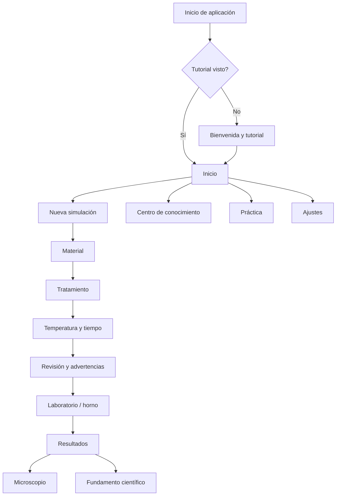

# FERROLAB — 07 Frontend Flutter

**Estado:** especificación de implementación · **Idioma base:** español · **Objetivo:** cliente Flutter para iOS, Android, web y escritorio.

## 1. Contrato del frontend

Flutter presenta simulaciones y resultados emitidos por FastAPI/FSE. **No calcula porcentajes de fases, dureza, Ms ni curvas científicas**. Nunca presenta números ilustrativos como predicciones. Si un dato no está validado, muestra «No disponible con los datos científicos actuales» y explica el motivo.

El diseño es educativo, minimalista, inspirado en patrones de claridad y navegación de Apple Health, sin copiar recursos propietarios. Usar fuentes de sistema (San Francisco en plataformas Apple donde esté disponible; alternativas de sistema en otras), sin distribuir archivos de fuente Apple. Los colores Sulphur Yellow, Peach Red, Yellow Green y Light Green son tokens con valores HEX por confirmar y ajustar para contraste WCAG; no inventar códigos oficiales.

## 2. Alcance y prioridades

**P0, indispensable:** bienvenida y tutorial saltable; inicio; selección de AISI 1045, AISI 8620 y ASTM A48 Clase 30; seis tratamientos (temple, revenido, recocido, normalizado, austempering, martempering); validación de combinaciones; controles de temperatura 20–1600 °C y tiempo con entrada precisa; simulación visual acelerada; resultados científicos trazables; micrografía licenciada con zoom; estados de carga/error; español/inglés; ajustes; accesibilidad básica.

**P1:** gráficos TTT/CCT cuando existan datasets validados, comparador, historial local, glosario, fichas de fases, modo práctica, explicación IA con fuente.

**P2:** inspector de fases con máscaras verificadas, medición de grano calibrada, vista dividida Fe-C/microestructura, modo profesor con códigos, gamificación, notificaciones opt-in y sonidos.

No prometer que P1/P2 estará completo en una semana. La entrega requiere validación real, no solo pantallas.

## 3. Navegación y pantallas



Mantener máximo 4 accesos principales en inicio: Nueva simulación, Explorar microestructuras, Centro de conocimiento, Modo práctica. El resto se accede contextualmente. Usar `go_router` con rutas tipadas y navegación accesible.

### 3.1 Bienvenida / tutorial

Tres pasos visuales: elegir material; configurar y ejecutar; interpretar microestructura y fundamentos. Botón «Omitir»; persistir preferencia local. No pedir cuenta ni permisos en el primer arranque.

### 3.2 Selector de material

Tarjetas con nombre, tipo, composición y resumen **solo si el backend devuelve datos verificados**. Ficha de material con microestructura inicial, aplicaciones y limitaciones. No asumir que todos los tratamientos son válidos para todos los materiales.

### 3.3 Configuración de tratamiento

Selector de tratamiento con descripción, prerrequisitos y advertencias. Slider 20–1600 °C más campo numérico accesible; tiempo con unidad explícita (minutos), límites derivados del backend. El rango de la interfaz no significa que cualquier temperatura sea metalúrgicamente válida. Medio de enfriamiento **fijo por combinación material + tratamiento y condiciones**, decidido por el FSE y mostrado como solo lectura. Revenido requiere estado previo templado o un estado inicial científicamente definido; solicitarlo o deshabilitarlo si falta. No simular un resultado inexistente.

### 3.4 Laboratorio / horno

Representación 2D/2.5D frontal inspirada en un horno Metalar de laboratorio, sin utilizar logotipos ni planos protegidos sin permiso. Elementos: puerta, cámara, resistencia, pieza, temperatura, tiempo, fase del proceso, botón pausa/reanudar y progreso. El color de la pieza varía gris → rojo oscuro → rojo → naranja → amarillo → blanco, como **visualización orientativa**, no termometría de color precisa. Mostrar simultáneamente `Tiempo de proceso simulado` y `Duración de animación`. El calentamiento, permanencia y enfriamiento son etapas distintas; el tiempo de permanencia configurado no se confunde con la duración acelerada de pantalla. Los gráficos muestran la trayectoria únicamente si existe información de referencia validada. Respetar `reduceMotion` y ofrecer modo sin animaciones.

### 3.5 Resultados

Jerarquía: microestructura representativa → nombre/estado de evidencia → fases con fracciones y método → dureza con escala y rango/ incertidumbre → propiedades → aplicaciones → explicación → fundamento científico. No mostrar `58 HRC` o `85 % martensita` como ejemplo de predicción real. Mostrar `estimación`, supuestos, fuente, versión del FSE, fecha de validación y limitaciones. Los porcentajes solo suman 100 % si el modelo realmente representa un conjunto exhaustivo de constituyentes mutuamente excluyentes.

### 3.6 Microscopio virtual

Usar `InteractiveViewer` con pan y zoom limitado por resolución; zoom digital no crea detalle nuevo. Cambiar a imágenes reales de diferentes aumentos solo si corresponden al mismo material/estado y cuentan con escala y metadatos. Escala micrométrica únicamente cuando haya calibración. Etiquetas de fases solo con anotaciones o máscaras revisadas; sin identificación automática especulativa. Mostrar atribución y licencia de cada imagen. Si no hay micrografía compatible, mostrar ilustración explícitamente etiquetada o estado sin imagen; nunca representar una imagen ajena como evidencia del experimento.

### 3.7 Centro de conocimiento y práctica

Contenido de materiales, fases, tratamientos, TTT/CCT y glosario enlazado a bibliografía. Modo práctica: hipótesis antes de ejecutar y comparación con resultado sustentado. Evitar mensajes de corrección que sugieran cambios de temperatura no fundamentados.

### 3.8 Ajustes

Idioma ES/EN, tema sistema/claro/oscuro, sonido, animaciones, tutorial, privacidad y fuentes. Historial/favoritos locales sin cuentas; explicar borrado de datos. Notificaciones desactivadas por defecto y con consentimiento explícito.

## 4. Estructura de código

```text
frontend/flutter_app/
  lib/
    main.dart
    app/
      app.dart
      router.dart
      localization/
    core/
      design_system/
      networking/
      errors/
      accessibility/
      storage/
    features/
      onboarding/
      home/
      materials/
      treatments/
      simulation/
      results/
      microscope/
      knowledge/
      practice/
      settings/
      ai_tutor/
    shared/
      models/
      widgets/
  test/
  integration_test/
  assets/
```

Por feature, separar `presentation/`, `domain/`, `data/` cuando la complejidad lo justifique. Estado: Riverpod (proveedores para repositorios, selección y simulación); `go_router` para rutas; `dio` o `http` con timeouts y manejo consistente de errores; `flutter_localizations` + `intl` para ES/EN. Mantener dependencias mínimas y versiones fijadas en lockfile. La selección de librerías se verifica contra soporte actual antes de instalarlas.

## 5. Modelos y contrato API

Usar DTOs tipados y validación de esquema. Endpoints esperados (alinear con `06_Backend_FastAPI.md`):

- `GET /api/v1/materials`
- `GET /api/v1/materials/{id}`
- `GET /api/v1/materials/{material_id}/treatments`
- `POST /api/v1/simulations/validate`
- `POST /api/v1/simulations`
- `GET /api/v1/simulations/{id}` únicamente si en una fase futura se implementan trabajos asíncronos (fuera de P0)
- `POST /api/v1/tutor/explain` opcional, con resultado validado como contexto

Contrato conceptual de simulación (no asumir valores):

```json
{
  "material_id": "aisi_1045",
  "treatment_id": "quench",
  "initial_condition_id": "example-condition-id",
  "target_temperature_c": 850,
  "hold_time_min": 30,
  "locale": "es"
}
```

La respuesta canónica expone `simulation_status`, `request_id`, `dataset_version`, `protocol_version`, `engine_version`, `model_version`, `input`, `compatibility_status`, `protocol`, `thermal_history`, `results`, `micrograph`, `diagrams`, `warnings`, `evidence` y `assumptions`. Cada magnitud tiene metadatos de fuente y unidad cuando existe; el valor no disponible es `null`. **No fijar números metalúrgicos en código de producción.**

## 6. Máquina de estados de simulación

`idle → validating → ready → requesting_result → playback_heating → playback_hold → playback_cooling → showing_results` con ramas `invalid`, `scientific_limitation`, `network_error`, `cancelled`. El backend determina el resultado; la animación solo lo representa. Si falla red, mostrar reintentar sin duplicar operaciones; usar identificador idempotente cuando corresponda. Nunca mostrar éxito científico si no llegó respuesta validada.

## 7. Diagramas interactivos

Renderizar curvas a partir de series de datos con fuente, unidades y rango. Eje de tiempo logarítmico cuando corresponda; distinguir TTT (isotérmico) de CCT (enfriamiento continuo). No trazar trayectoria CCT sobre TTT como si fueran equivalentes. No dibujar curvas genéricas como si fueran de AISI 1045, 8620 o A48 Clase 30. Si faltan datos, ofrecer explicación conceptual claramente rotulada.

## 8. Diseño y accesibilidad

Tokens semánticos: `colorPrimary`, `colorAccent`, `colorWarning`, `colorSurface`, `textPrimary`, `textSecondary`, `phaseColors`; paleta definida posteriormente en `08_Design_System.md`. Tamaños táctiles objetivo >= 48 × 48 puntos lógicos, texto escalable, foco de teclado, contraste WCAG AA cuando sea posible, semántica para lectores de pantalla, no depender solo de color para fases o alertas. Animaciones suaves orientadas a 60 fps, sin prometer 120 fps en todos los dispositivos. Layout adaptable: móvil (una columna), tablet (dos paneles), escritorio/web (laboratorio + inspector lateral).

## 9. Manejo de red, costos y privacidad

La app requiere internet para consultar FSE/IA según la decisión de producto; guardar únicamente preferencias e historial local si se habilita. No incluir claves de servicio de Supabase, tokens de IA ni secretos en Flutter. Las imágenes deben tener URLs controladas y política de caché; optimizar miniaturas. El servicio de IA es opcional: si falla o excede presupuesto, la simulación y explicación estática basada en datos deben seguir funcionando. **Una IA en nube no garantiza costo cero**; definir proveedor y límites antes de habilitarla públicamente. La ausencia de login de usuario no elimina la necesidad de controles antiabuso, cuotas ni autenticación robusta para el administrador.

## 10. Pruebas y aceptación

- Widget tests: onboarding, sliders y entrada numérica sincronizados, traducción, tema, errores.
- Integration tests: recorrido completo de material → tratamiento → parámetros → resultado con backend simulado.
- Contrato: `unsupported` nunca presenta dureza/fases ficticias; advertencias visibles; fuentes y versión visibles.
- Microscopio: límites de zoom, escalas solo calibradas, atribución persistente.
- Rendimiento: medir frame drops en móvil de gama media; probar web y escritorio.
- Accesibilidad: navegación con teclado, lector de pantalla, texto grande y reducción de movimiento.
- Seguridad: ningún secreto en bundle, ni rutas administrativas públicas desde cliente normal.
- Localización: todo texto visible traducido; unidades consistentes; no strings incrustados en widgets.

**Criterio de entrega:** flujo P0 operativo en las plataformas efectivamente probadas, con resultados científicos soportados o rechazo explícito de casos no validados. La cobertura de las 18 combinaciones teóricas (3 × 6) no se da por válida sin respaldo científico específico.

## 11. Instrucciones obligatorias para Claude Code

1. Leer `README.md`, `02_PRD.md`, `03_Arquitectura_Software.md`, `04_Motor_Cientifico_FSE.md`, `05_Modelo_de_Datos.md` y este documento antes de codificar.
2. Implementar primero flujo P0 con repositorio mock **marcado como mock**; sustituirlo por API real antes de declarar entrega.
3. No introducir cifras, curvas ni micrografías inventadas en producción.
4. Documentar decisiones y discrepancias entre especificaciones; elevar conflictos en lugar de asumir.
5. Ejecutar `flutter analyze`, tests y builds disponibles, reportando plataformas no verificadas.
6. Mantener separadas animación, cálculo, recuperación de imágenes e interpretación IA.
7. Priorizar estabilidad y comprensión educativa sobre efectos visuales.

## 12. Dependencias de otras especificaciones

- `04_Motor_Cientifico_FSE.md`: límites de validez científica y semántica de resultados.
- `05_Modelo_de_Datos.md`: material, tratamiento, fuentes y micrografías.
- `06_Backend_FastAPI.md`: endpoints y errores; resolver diferencias antes de implementar.
- `08_Design_System.md`: tokens definitivos y componentes.
- `09_UX_UI.md` y `10_Wireframes_y_Flujos.md`: layouts detallados.
- `13_Pruebas_y_Validacion.md`: aceptación final.

---

## 13. Anexo v2 — arquitectura de pantallas y componentes

### 13.1 API y modelo compartido

Adoptar **`/api/v1`**. El cliente lee `simulation_status` y `compatibility_status` de la API como enums; no recalcula estados con reglas locales distintas. El catálogo de materiales y tratamientos se obtiene del backend, con caché por versión; un fallo de red puede mostrar información editorial cacheada identificada como tal, pero **no** ejecutar cuantificaciones científicas falsas.

```dart
sealed class SimulationUiState {}
class Editing extends SimulationUiState {}
class Validating extends SimulationUiState {}
class ReadyToRun extends SimulationUiState {}
class Running extends SimulationUiState {}
class Playback extends SimulationUiState {}
class ShowingResults extends SimulationUiState {}
class ScientificLimitation extends SimulationUiState {}
class NetworkError extends SimulationUiState {}
```

Los estados `ScientificLimitation` y `NetworkError` no son lo mismo. El primero requiere fundamento científico y puede mostrar contenido educativo; el segundo debe ofrecer reintento.

### 13.2 Widgets recomendados y contratos

| Widget | Datos fuente | Interacción | Comportamiento sin evidencia |
|---|---|---|---|
| `MaterialCard` | catálogo aprobado | seleccionar y leer ficha | enseña límite, no inventa composición. |
| `TreatmentCard` | compatibilidad | seleccionar | deshabilita si `unsupported`; explicación visible. |
| `TemperaturePicker` | rango del horno + dominio | slider y entrada precisa | marca rango inválido y desactiva «Continuar». |
| `HoldTimePicker` | límites del protocolo | minutos | describe etapa a la que se refiere. |
| `CoolingProtocolCard` | protocolo servidor | **solo lectura** | «Protocolo pendiente de revisión». |
| `FurnaceCanvas` | historial `thermal_history` | pausar / reproducir / reducir movimiento | no cambia cálculos. |
| `ThermalChart` | historial térmico | inspección de puntos/ejes | muestra etapas sin suavizado engañoso. |
| `ResultFactCard` | hecho con evidence | abrir fuente/advertencia | marcador «No estimable», no `0`. |
| `PhaseBreakdown` | fases o microconstituyentes | inspección de categoría | no sumar categorías solapadas. |
| `MicrographViewer` | asset aprobado | pinch, pan, escala | placeholder informado. |
| `DiagramViewer` | puntos aprobados | pan/zoom/ejes | no dibujar curvas ficticias. |
| `EvidenceDrawer` | provenance | abrir cita exacta | marca referencia incompleta. |

### 13.3 Reproducción y rendimiento

`FurnaceCanvas` usa ticker/animación de Flutter y `CustomPainter` cuando sea útil. No renderizar un vídeo pesado como requisito P0. Mapa visual de temperatura **ilustrativo**, no calibración de radiación térmica: pieza gris→rojo oscuro→rojo→naranja→amarillo→blanco en tramos de diseño, acompañada por una **lectura numérica de la temperatura del historial**. Etiqueta «representación visual» disponible. Al reducir movimiento, mostrar cortes de estado y gráfica estática. La animación debe ser pausable y repetible; el historial real conserva unidades y tiempos de proceso.

Para micrografías grandes: miniatura primero, zoom por `InteractiveViewer`, límites físicos de resolución; si se ofrece 100×/500×/1000×, requerir imagen o calibración real correspondiente. No modificar estructuras mediante generación IA fotorrealista y etiquetarlas como experimento.

### 13.4 Errores, accesibilidad e internacionalización

- Botones con texto visible, tamaño táctil adecuado y `Semantics` por cada control.
- No usar el color solo para comunicar `validated` frente a `insufficient_evidence`; icono + texto.
- Pantallas pequeñas: ancho adaptable, una columna; tablets/web: split view de simulación/gráfica.
- Idiomas `es` y `en` mediante ARB/localización oficial de Flutter. Ejemplo de key: `scientificInsufficientEvidence`, no textos literales dispersos.
- Soportar alto contraste, textos escalados y teclado; focus y lectores de pantalla probados manualmente.
- Sonidos, notificaciones locales y animaciones secundarias desactivables; opt-in explícito.
- Registro local mínimo sin datos sensibles y opción «Eliminar historial»; no prometer sincronización.

### 13.5 Contrato de diseño

Consumir `08_Design_System.md` para colores, tipografía, espaciado y elevación. Los colores «Sulphur Yellow», «Peach Red», «Yellow Green» y «Light Green» son identificadores de familias cromáticas. Sus HEX v2 son **propuestas visuales del proyecto**, no estándares certificados por el nombre. Verificar contraste por combinación y modo, no solo por color aislado. SF Pro se usa mediante tipografía del sistema en sistemas Apple donde corresponde; no incluir archivos redistribuidos de SF Pro en el repositorio.

### 13.6 Plan de componentes y tests

1. Generar modelos tipados de OpenAPI y tratar `null`/enums exhaustivamente.
2. Implementar `CatalogRepository`, `SimulationRepository`, `KnowledgeRepository` y `TutorRepository` (opcional) con adaptadores fake para tests.
3. Conectar flujos `Editing → Validating → ReadyToRun → Running → Playback → ShowingResults`; manejar `ScientificLimitation` sin bloquear lectura.
4. Construir tests de widget: selector 3 materiales, 6 tratamientos, validación de temperatura, perfil no editable, resultado sin dureza, fallbacks de micrografía y de IA.
5. Añadir golden visual tests en móvil y web cuando el diseño esté estabilizado; auditoría manual WCAG/semantics.
6. Publicar **web primero**; verificar compilaciones de Android/iOS/desktop solo cuando exista el entorno correcto y los requisitos de distribución.

**Criterio crítico:** una interfaz impecable no justifica un valor inventado. Si el backend devuelve `null`, el widget no sustituye ese valor por una constante, interpolación visual o porcentaje predeterminado.
