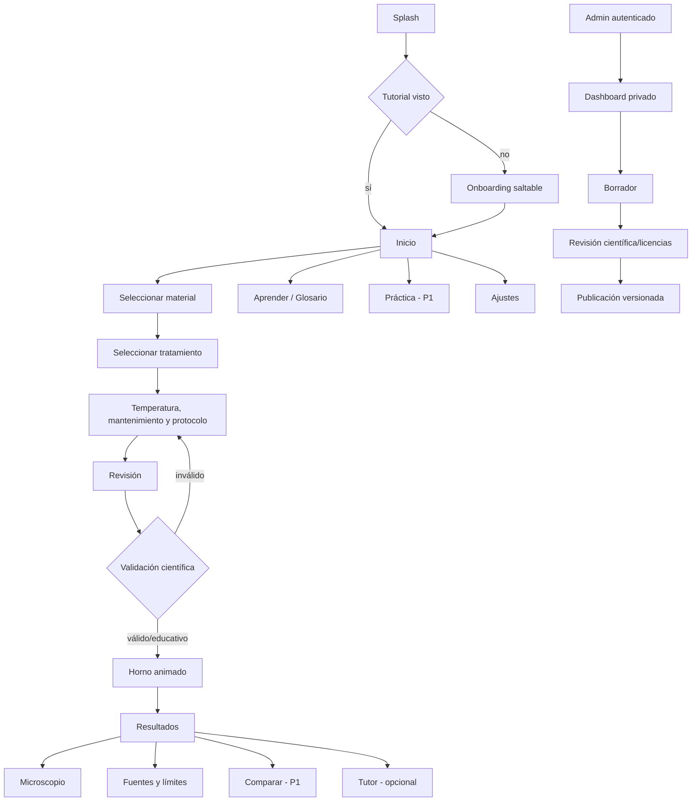

# 10 — Wireframes y flujos de FERROLAB

**Versión:** 2.0 · **Naturaleza:** wireframes textuales de baja fidelidad, **no** diseño gráfico final.  
**Fuente de tokens:** `08_Design_System.md` · **Fuente de microcopy:** `09_UX_UI.md`.

## 1. Convenciones de prototipado

- `[Primario]`: CTA único visible; `[Secundario]`: acción auxiliar; `(i)`: información/cita; `[🔒]`: bloqueado por protocolo; `—`: dato no disponible.
- Ancho móvil de referencia 360–390 px lógicos. En web usar un ancho de lectura de ~1100 px y columnas para laboratorio/resultados.
- Todos los wireframes representan contenido y jerarquía; no son números metalúrgicos ni valores aprobados.

## 2. Mapa de pantallas



## 3. Pantalla A — Bienvenida

```text
┌────────────────────────────────────┐
│ FERROLAB                     ES ▾ │
│                                    │
│       [Ilustración de horno]       │
│                                    │
│  Entiende cómo el calor            │
│  transforma los metales.           │
│                                    │
│  Explora tratamientos térmicos     │
│  con simulaciones educativas.      │
│                                    │
│  [   Comenzar   ]                 │
│  Omitir introducción               │
│                                    │
│  Gratis · Sin cuenta               │
└────────────────────────────────────┘
```

**Notas:** onboarding de máximo 3 pasos; se puede omitir siempre. Mostrar origen científico y advertencia breve, no prometer resultados industriales.

## 4. Pantalla B — Inicio

```text
┌────────────────────────────────────┐
│ FERROLAB                [Ajustes] │
│                                    │
│ Buen día, ¿qué exploramos?         │
│                                    │
│ ┌────────────────────────────────┐ │
│ │ Laboratorio virtual            │ │
│ │ Elige material y tratamiento   │ │
│ │ [ Iniciar simulación ]         │ │
│ └────────────────────────────────┘ │
│                                    │
│ [Aprender] [Microestructuras P1]  │
│ [Modo práctica P1]                 │
│                                    │
│ Educativo · Consulta las fuentes  │
└────────────────────────────────────┘
```

## 5. Pantalla C — Elegir material

```text
┌────────────────────────────────────┐
│ ← Laboratorio            Paso 1/4 │
│ Elige un material                  │
│ ┌────────────────────────────────┐ │
│ │ ○ AISI 1045                    │ │
│ │   Acero de carbono medio       │ │
│ │   (i) Ver ficha                │ │
│ ├────────────────────────────────┤ │
│ │ ○ AISI 8620                    │ │
│ │   Acero aleado bajo carbono    │ │
│ │   Capa cementada: no asumida   │ │
│ ├────────────────────────────────┤ │
│ │ ○ ASTM A48 Clase 30            │ │
│ │   Fundición gris               │ │
│ │   Composición variable         │ │
│ └────────────────────────────────┘ │
│ [ Continuar ]                      │
└────────────────────────────────────┘
```

## 6. Pantalla D — Elegir tratamiento

```text
┌────────────────────────────────────┐
│ ← Material               Paso 2/4 │
│ Elige un tratamiento               │
│ [Temple]        [Revenido]         │
│ [Recocido]      [Normalizado]      │
│ [Austempering]  [Martempering]     │
│                                    │
│ Estado: educativo / condicional   │
│ Se explica qué datos faltan.       │
│ (i) ¿Por qué no está habilitado?   │
│ [ Continuar ]                      │
└────────────────────────────────────┘
```

Cada tarjeta se alimenta de `GET /api/v1/materials/{id}/treatments`. Los estados desconocidos no son silenciosamente verdes o «soportados».

## 7. Pantalla E — Parámetros

```text
┌────────────────────────────────────┐
│ ← Tratamiento            Paso 3/4 │
│ Configura tu experimento           │
│                                    │
│ Temperatura objetivo               │
│ [  [────────●──────]   ]  °C      │
│ [  850  ]   Valor ilustrativo      │
│ Rango permitido: según protocolo  │
│                                    │
│ Tiempo de mantenimiento           │
│ [  30 ] minutos (etapa indicada)  │
│                                    │
│ Enfriamiento [🔒]                 │
│ Definido por protocolo revisado   │
│ (i) Etapas y condiciones           │
│                                    │
│ [ Revisar configuración ]          │
└────────────────────────────────────┘
```

**Los valores 850 y 30 son texto de maqueta**, no receta de tratamiento ni aprobación de esa condición. La versión final mostrará rangos reales desde API y desactivará CTA si no cumple.

## 8. Pantalla F — Revisión y validación

```text
┌────────────────────────────────────┐
│ Tu experimento            Paso 4/4 │
│ Material      [Ficha aprobada]     │
│ Tratamiento   [Protocolo]          │
│ Temperatura   [Tu selección]       │
│ Tiempo        [Tu selección]       │
│ Estado inicial[Catálogo]           │
│ Enfriamiento  [Automático 🔒]     │
│                                    │
│ Atención: algunos valores pueden  │
│ no ser estimables.                 │
│ [ Iniciar laboratorio ]            │
│ [ Editar ]                         │
└────────────────────────────────────┘
```

Si `invalid_input`, devolver al parámetro con foco y explicación; si `unsupported`, mostrar fundamento y opción de elegir otro tratamiento.

## 9. Pantalla G — Horno y gráfica

```text
┌────────────────────────────────────┐
│ Laboratorio      Etapa: enfriando  │
│                                    │
│          ┌────────────┐            │
│          │  [HORNO]   │            │
│          │   [PIEZA]  │            │
│          └────────────┘            │
│ Temperatura: [°C desde FSE]        │
│ Tiempo físico: [min:s]             │
│ Reproducción: 16×  [▶][❚❚][⏭]    │
│                                    │
│ Gráfico temperatura vs. tiempo     │
│ [trazo por etapas verificadas]     │
│ Color de pieza: ilustrativo        │
│ [ Ver resultados ]                 │
└────────────────────────────────────┘
```

El botón saltar no recalcula: lleva a la última muestra del mismo historial. Si `reduceMotion`, usar etapas fijas y gráfica/tabla.

## 10. Pantalla H — Resultados

```text
┌────────────────────────────────────┐
│ Resultado de tu experimento        │
│ [Estado científico] [Ver límites] │
│                                    │
│ Tratamiento y trayectoria          │
│ [Gráfica con ejes y fuente]        │
│                                    │
│ Microconstituyentes / fases        │
│ [descripción o datos respaldados]  │
│                                    │
│ Dureza final: —                    │
│ No estimable con evidencia actual  │
│ [ ¿Qué datos faltan? ]             │
│                                    │
│ [ Microscopio ] [ Fundamento ]     │
│ [ Comparar P1 ] [ Nueva prueba ]   │
└────────────────────────────────────┘
```

Se muestran campos independientes; si un valor existe, deberá traer unidad, estado `evidence_level` y referencia. No sustituir `null` por 0 o por dibujos porcentuales.

## 11. Pantalla I — Microscopio

```text
┌────────────────────────────────────┐
│ ← Resultados      Microestructura  │
│ [ Imagen autorizada o placeholder] │
│                                    │
│ [ − ] Zoom digital: 2× [ + ]      │
│ Escala física: solo si calibrada   │
│                                    │
│ Material / condición / técnica    │
│ Fuente / autor / licencia          │
│ [ Metadatos ] [ Ver original ]     │
└────────────────────────────────────┘
```

En ausencia de coincidencia, no desplegar imagen genérica bajo el título del material elegido. Puede enlazar «Ejemplos relacionados, **no representativos**» con etiqueta muy visible.

## 12. Panel admin — recorrido mínimo

```text
┌────────────────────────────────────────────────────────┐
│ FERROLAB ADMIN                 Editor verificado        │
├───────────────┬────────────────────────────────────────┤
│ Materiales    │ Ficha: AISI 1045                      │
│ Protocolos    │ Estado: Borrador                      │
│ Evidencia     │ [Fuente] [Localizador] [Licencia]     │
│ Diagramas     │ Composición/rango/estado inicial      │
│ Micrografías  │ [Validar unidades] [Solicitar revisión]│
│ Publicaciones │ Historial y diff                      │
│ Auditoría     │ [Publicar versión] (rol autorizado)   │
└───────────────┴────────────────────────────────────────┘
```

El editor puede preparar sin publicar. El aprobador debe validar ciencia y derecho de uso. Todo cambio genera auditoría.

## 13. Rutas de navegación y errores

| Evento | Pantalla resultante | Regla |
|---|---|---|
| Atrás desde parámetro | Tratamiento | Mantener selección. |
| Cambiar material | Tratamiento | Limpiar protocolo incompatible, conservar solo datos seguros. |
| Salir del horno | Confirmación ligera | Mantener resultado ya calculado mientras dure la sesión. |
| Desconexión | Estado de red | Reintentar sin perder formulario. |
| Rechazo científico | Revisión con fundamento | No iniciar animación como si hubiera cálculo completo. |
| IA apagada | Explicación editorial | No pedir al usuario tarjeta ni cuenta. |
| Sin micrografía | Estado vacío | Mostrar origen/condición faltantes. |
| Publicación revocada | Referencia no disponible | Proteger datos y explicar diferencia de versiones. |

## 14. Adaptaciones web y escritorio

Web/tablet: selector y ficha lateral, horno a izquierda y gráfica a derecha, resultados por tarjetas de dos columnas, panel de fundamentos expandible. Desktop mantiene rutas de teclado; móvil reorganiza una columna. No exigir hover para información esencial. Mantener orden lógico de foco y la misma semántica científica en todos los tamaños.

## 15. Pruebas de recorrido

1. Persona novata selecciona material/tratamiento y explica qué significan temperatura/tiempo.
2. AISI 8620 muestra limitación de capa cementada.
3. A48 muestra que es fundición gris y que la clase de resistencia no fija composición.
4. Campo inválido devuelve foco y corrección.
5. Sin curvas validadas, no se dibuja gráfico científico de transformación.
6. Sin micrografía, el estado vacío informa y no etiqueta imagen falsa.
7. Con IA apagada, existe explicación y fuente.
8. El mismo ciclo puede reproducirse más rápido o saltarse sin cambiar las conclusiones.
